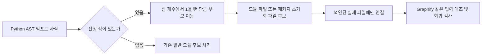
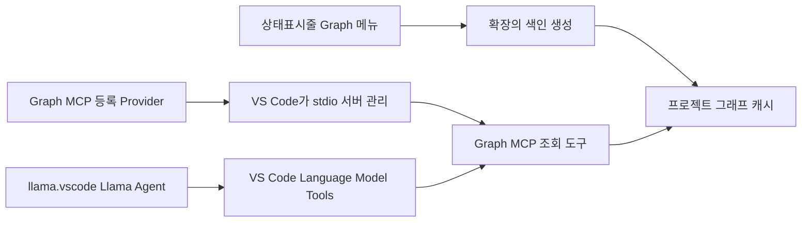
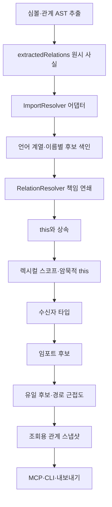

# Graph MCP와 llama.vscode 연결·Graphify 비교 및 구현 보고서

## 2026-10-29 Graphify 대비 성능 직접 검증

### 비교를 다시 구성한 이유와 범위

이전 2,500개 이름 해석 측정은 수행 범위가 다른 함수를 비교하므로 엔진 전체가 Graphify와 동등하거나 우세하다는 근거가 될 수 없었다. 이번에는 원본 파일 복사본을 양쪽에 동일하게 공급하고 **AST 추출 → 교차 파일 관계 해석 → 각 엔진의 캐시 및 JSON 저장**을 측정한다. 제품 코드는 수정하지 않으며 검사와 워커는 `.test/`에 둔다.

대상은 로컬 `graphifyy 0.9.97`, Python 3.12.15와 현재 lightweight 소스의 TypeScript 컴파일 결과다. Graphify는 순차 실행과 `parallel=True, max_workers=4` 두 설정을 모두 측정한다. 해당 버전의 병렬 추출은 미캐시 파일 20개 이상에서만 동작한다. 전체 CLI/LLM/문서·미디어/Leiden/HTML·보고서 기능의 동일 작업 비교는 아니다. 런타임과 Tree-sitter 구현 및 출력 정보량도 서로 다르므로 범위를 넘어선 전면적 우세는 주장하지 않는다.

### 재현 방법과 판정 기준

검사는 `.test/performance.cjs`, `.test/performance-worker.cjs`, `.test/performance-worker.py`이며 `.test/performance-audit.cjs`가 완료 결과를 별도로 감사한다. 실행 명령은 다음과 같다.

```text
.build/nodejs/node/node.exe .test/performance.cjs <Graphify의 python.exe>
.build/nodejs/node/node.exe .test/performance.cjs <Graphify의 python.exe> --python-only
.build/nodejs/node/node.exe .test/performance-audit.cjs <생성된 .test/performance-* 경로> <Graphify의 python.exe>
```

- 입력: 현재 엔진 `src`의 TS 소스, `NativeSound`의 JS 소스, TS/JS/Python 각 1/3의 합성 30파일 및 300파일, Python 전용 300파일. 실제 프로젝트 원본은 읽기만 하고 복사본만 변경한다. 설치 Graphify는 JS/TS를 `_JS_CACHE_BYPASS_SUFFIXES`로 정해 자체 AST 캐시를 우회하므로 Python 전용 입력으로 캐시가 적용되는 조건도 비교한다. 그 정책을 검사용으로 바꾸지 않는다.
- 5개 독립 블록마다 새 입력/캐시 경로를 만들고 세 엔진 설정의 실행 순서를 회전한다. 워커는 동시에 실행하지 않는다. OS 파일 캐시는 비우지 않으므로 cold는 **새 프로세스·빈 AST 캐시**를 뜻한다.
- cold: 프로세스 생성부터 최초 JSON 저장 결과 수신까지의 경과 시간. warm: 같은 프로세스에서 전체 파일 재갱신을 3회 실행한 중앙값. changed: 첫 파일에 실제 함수 선언 하나를 추가한 뒤 전체 파일 재갱신. restart: 변경 파일과 디스크 캐시를 남기고 새 프로세스에서 전체 재갱신한 첫 결과 시간.
- lightweight는 메모리 AST 캐시를 사용한다. 재시작 시 내부 그래프 스냅샷을 읽어 조회하는 성능을 재색인 성능으로 대신하지 않고 실제 파일 재검사를 수행한다. Graphify는 자체 디스크 AST 캐시를 사용한다. warm/changed는 준비 완료 후 처리 시간이며 cold/restart는 인터프리터·모듈·문법 준비도 포함한다.
- 두 Graphify 설정 중 각 조건에서 더 빠른 중앙값을 비교 기준으로 삼는다. 같은 블록에서도 둘 중 빠른 Graphify와 비교해 5블록 모두 lightweight가 10% 이상 빠른 경우에만 그 표본/조건의 측정 우세로 표시한다. ±10%는 실용적 판정 허용폭이며 통계적 동등성 검정이나 모든 입력에 대한 보장이 아니다.
- 결과 감사는 모든 엔진/반복의 정렬된 파일 내용 해시가 같은지, 변경한 심볼이 정확히 하나 추가됐는지, 재시작 전후 노드·관계 수가 같은지 확인한다. 합성 입력의 정답 호출은 파일당 4개이며 별도로 JS 생성자 호출도 허용한다. 지정 호출자의 잘못된 추가 연결도 검사한다. 실제 소스의 모든 관계에 수작업 정답을 부여하지 않았으므로 전체 정확도 우세와 속도 측정 우세를 구분한다.


### 정확도 보강 전의 측정 결과

5블록 측정과 별도 감사가 완료됐다. 기본 결과는 `.test/performance-9BA8nP/{result,audit}.json`, Python 전용 결과는 `.test/performance-t3Bgpj/{result,audit}.json`에 보존했다. 장비는 Intel N100/논리 코어 4개, Windows 10.0.26300, Node v24.22.1이다. Graphify 4워커는 이 장비의 기본 CPU 병렬도와 같다. Python 전용 로그에서 실제 4워커 추출, 반복/재시작 시 300/300 캐시 적중, 변경 시 299/300 적중을 확인했고 fallback도 없었다.

아래는 각 조건의 5블록 중앙값이며 Graphify는 순차·병렬 중 더 빠른 중앙값을 표시한다. **이 표의 엔진은 아래 정확도 보강 전 소스다. 최종 소스의 성능으로 대체하지 않는다.**

| 입력 | 첫 실행 lightweight / Graphify | 프로세스 내 재실행 lightweight / Graphify | 해석 |
| --- | --- | --- | --- |
| 엔진 TS 소스 18파일 | 2,021.6 / 3,952.9ms | 104.8 / 2,997.7ms | 이 표본의 두 조건에서 모든 블록의 lightweight 우세 |
| NativeSound JS 5파일 | 554.4 / 1,237.7ms | 9.6 / 143.0ms | 첫 실행의 개별 블록에는 우열 혼재 |
| 혼합 30파일 | 550.6 / 2,077.1ms | 43.7 / 366.0ms | 이 표본의 두 조건에서 모든 블록의 lightweight 우세 |
| 혼합 300파일 | 3,121.0 / 7,292.3ms | 3,539.0 / 3,669.5ms | 재실행 중앙값은 가깝지만 개별 블록은 우열 혼재 |
| Python 300파일 | 2,406.8 / 6,923.4ms | 2,787.0 / 3,188.0ms | 재실행에서 모든 블록의 10% 우세를 입증하지 못함 |

합성 30파일의 지정 호출 120개, 혼합/Python 300파일 각각 1,200개를 두 엔진 모두 찾았고 합성 입력 전체의 추가 오연결은 없었다. 모든 입력 파일이 결과에 포함되고 변경 함수가 정확히 하나 추가되며 재시작 전후 노드·관계 수가 같음을 감사했다. 원본 입력은 엔진/반복 간 바이트 해시가 같았다.

감사에서 변경 시나리오의 Python 워커가 Windows 기본 CRLF로 함수 두 줄을 덧붙이는 차이를 발견했다. 원본 입력 해시는 추가분을 제거해 별도로 검증했고, 변경/재시작 표본의 추가 줄바꿈은 `audit.json.changeNewlines`에 기록했다. 따라서 당시 변경/재시작 수치는 같은 AST 코드의 참고 측정이며 수정 후 입력까지 바이트 동일하다고 주장하지 않는다. `.test/performance-newline.cjs`가 먼저 실패함을 확인한 뒤 Python 워커의 `newline=""`로 수정해 Node/Python의 변경 후 바이트 동일 검사도 통과했다. 원본이 같은 첫 실행·warm 측정에는 이 차이가 없다.

### 정확도 우선 검증과 수정

사용자가 정확도 우선순위를 명시한 뒤 `.test/accuracy.cjs`로 별칭·스코프·수신자 혼동을 분리한 프로젝트 반례를 추가했다. 선언의 파일·시작 행·이름을 수작업 앵커로 지정해 엔진별 ID를 정답으로 간주하지 않으며, 호출 누락뿐 아니라 감시 대상 호출자의 잘못된 확정 연결도 센다. 전체 코드베이스를 무작위 표집한 정확도 추정은 아니다.

- 최초 17개 반례(`.test/accuracy-RjYQZN/result.json`): lightweight 지정 호출 13개 중 1개, 오연결 6개. Graphify는 7개, 오연결 3개. 기존 단순 합성 입력의 1,200/1,200만으로 일반 정확도 우세를 주장할 수 없음을 확인했다.
- 보강 후 26개 반례(`.test/accuracy-Zezj9e/result.json`): lightweight 지정 호출 16/16·오연결 0, Graphify 10/16·오연결 6. 이 반례 집합에서만 lightweight의 재현율/정밀도가 각각 100%, Graphify는 각각 62.5%다.
- 수정 범위: `relations.ts`에서 타입 미상 매개변수·기본값·Python 지역 값도 바깥 타입을 가리게 했다. 바깥 함수의 타입을 렉시컬 순서로 찾고 TS 생성자 파라미터는 접근 제한자/readonly가 있는 실제 parameter property만 필드로 취급한다.
- `declarations.ts`, `relations.ts`에서 C++ 참조 선언자를 따라 파라미터 이름을 찾고 Java·C#·C++의 명시적 수신자를 보존한다. 다른 객체 호출을 현재 클래스 동명 메서드에 붙이는 오연결을 차단했다.
- 임포트의 원래 이름·로컬 별칭·네임스페이스·범위를 원시 Relation에 보존한다. 반복 임포트는 위치별 ID로 구분해 덮어쓰지 않으며, `RelationResolver`가 정확한 파일의 바인딩을 우선한다. 함수 내부 Python 임포트는 해당 범위에 한정한다. Python의 확장자 없는 로컬 모듈도 찾는다.
- 기본 내장 이름은 추출 전에 버리지 않는다. 같은 범위나 명시적 임포트로 재정의한 함수는 살리고, 근거 없이 다른 모듈의 동명 함수를 내장 호출에 붙이지 않는다. 값 바인딩이 이름을 가리는 가장 가까운 범위에서 호출 후보 탐색을 멈춘다.
- `types.ts`의 새 선택 메타데이터는 `cache.ts`에서 구조와 타입을 검증한다. 공개 MCP/CLI 인수와 런타임 의존성은 추가하지 않았다.

커밋 전 점검에서 내보낸 HTML의 라벨/경로/관계 속성 삽입과 잘못된 기존 JSON 설정 덮어쓰기도 재현했다. `.test/html-safety.cjs`, `.test/config-safety.ps1`의 실패를 확인한 뒤 HTML 텍스트·속성을 이스케이프하고, 기존 JSON 파싱 실패 시 쓰기를 중단하도록 수정해 통과했다. 실제 전역 설정은 변경하지 않았다. Windows PowerShell 5.1에서 한국어 스크립트가 올바르게 읽히도록 해당 ps1 파일에 UTF-8 BOM을 사용했다. package/lock 버전은 1.1.0으로 맞췄다.

최종 성능·원격 병합·배포 검증 및 커밋/푸시 결과는 후속 확인 후 아래에 기록한다. 알려진 한계는 경로별 재할당 흐름, 복잡한 동적 디스패치·별칭 재수출·모노레포 설정 전체 해석이다. 속도가 빨라도 정확도 기준을 통과하지 않으면 개선으로 판정하지 않는다.

## 2026-10-29 09:56 KST 추가 버그 수정·최적화 재검증

기존 변경과 이전 성능 기준본을 보존한 채 현재 소스를 검토했다. 이번에는 Python 상대 임포트의 실제 오연결을 수정하고, 기존 Jest fixture의 회귀를 복구했다. 관련 작업이므로 이 보고서를 갱신하며 별도 보고서나 중복 문서를 만들지 않았다.

### 원인과 수정 및 영향 범위

1. **Python 부모 패키지 임포트 오연결**: `ImportResolver`가 선행 점을 모두 제거해 `from ..helpers import ...`를 현재 폴더의 `helpers.py`로 연결했다. `src/core/imports.ts`에서 첫 점은 현재 패키지, 추가 점은 부모 이동으로 처리하고 상대 임포트에는 프로젝트 루트 대체 후보를 추가하지 않도록 했다. `.helpers`, `..helpers`, 모듈명이 없는 `from .. import`, 부모에 없고 루트에만 있는 동명 모듈의 네 반례를 검사했다. 수정 전 `.test/optimization-Bua4UH/` 입력에서 부모 대상 누락 assert가 실패했고, 수정 후 통과했다.
2. **기존 Jest fixture 불일치**: 13개 중 2개가 실패했다. fixture가 조회용 `relations`에만 사실을 넣었지만 현재 해석기는 `extractedRelations`에서 다시 시작하므로 입력이 사라졌다. fixture에 원시 관계 복사본을 넣어 실제 엔진의 데이터 흐름과 맞췄다. 운영 해석기를 과거 fixture에 맞춰 되돌리지 않았다.
3. **검사 배치**: 기존 Jest 파일 3개를 `tests/`에서 `.test/`로 이동하고 `jest.config.js`의 검색 패턴과 `.gitignore` 허용 규칙을 맞췄다. 새 프레임워크·의존성·공개 옵션은 추가하지 않았다. `.vscodeignore`는 이미 `.test/**`를 제외해 패키지 설정 변경이 필요 없었다.

수정 전 `ImportResolver`, `resolveImports`, `resolveImportPath`의 호출·검사 위치를 검색했다. 영향 경로는 `GraphIndex.resolveRelations → resolveImports → ImportResolver`이며 전체 생성·증분 갱신·MCP·CLI·확장이 공유한다. Python 상대 경로 분기만 변경하고 JS/TS·네이티브 경로 후보 처리는 유지했다. 기존 파일 삭제나 전역 설정 변경은 하지 않았다.



### Graphify 동일성 판단과 개선 이식 난이도

비교 대상은 로컬 설치 `graphifyy 0.9.97`이며 최신 원격 버전과 동일하다고 주장하지 않는다. `extractors/resolution.py::_resolve_python_module_path`의 부모 이동 규칙을 읽고 같은 fixture에 실제 함수를 실행했다. 최종 `.test/optimization-G4BKgy/result.json`에서 후보 선택 10개·추론 점수 `0.85`·Python 상대 임포트 4개가 통과했다. 후보/호출 해석 모듈 SHA-256은 결과 파일에 보존했다. Python 비교 함수는 Graphify 내부 API이므로 버전 변경으로 이름이나 시그니처가 바뀌면 검사 어댑터도 갱신해야 한다.

`.test/review-9UL3aI/result.json`의 정답 호출 16개에서 lightweight는 16개·지정 금지 관계 오연결 0개, Graphify는 15개·오연결 2개였다. 실제 `src` 복사본 비교는 같은 디렉터리의 `project-result.json`에 있다. Graphify 171노드·501관계, lightweight 205노드·528링크이며 대응 의미 관계 211개·280개 중 공통 206개다. 이 입력의 제한된 증거이며 전체 정확도 수치나 전체 로직 동일성을 뜻하지 않는다.

| 개선 종류 | 대응 위치 | 이식 난이도와 조건 |
| --- | --- | --- |
| 경로 후보 순서·상대 임포트 보정 | `src/core/imports.ts` | 낮음. 이번 수정처럼 기존 어댑터 한 분기와 실제 파일 반례로 반영 가능 |
| 동명 후보·테스트 경로·추론 점수 | `src/core/candidates.ts`, `resolution.ts` | 낮음~중간. 후보 선택 검사와 언어별 호출 회귀를 함께 통과해야 함 |
| TS 설정 상속·모노레포 패키지·별칭 바인딩 | `imports.ts`, `relations.ts`, 관계 메타데이터 | 중간~높음. 현재 없는 설정 탐색·바인딩 정보가 필요하므로 함수 복사만으로 적용 불가 |
| 반환값·콜백·동적 수신자 타입 흐름 | 추출기와 `RelationResolver` | 높음. 원시 사실의 확장과 캐시 호환, 오연결 방지 반례가 필요 |
| Leiden 커뮤니티·문서/미디어·Graphify CLI 전체 | 내보내기·분석·실행 계층 | 높음. 현재 라벨 전파·코드 전용 분석과 기능/의존성이 다르며 별도 요구가 필요 |

따라서 **일부 규칙은 같고 작은 개선은 이식하기 쉽지만 전체 엔진 로직은 다르다**. 커뮤니티 알고리즘·ID/스키마·언어별 해석 범위의 차이를 없앴다고 볼 수 없다. Graphify 결과도 반례의 정답을 대신하지 않는다.

### 검증과 성능

- 통과: 타입 검사(`tsc --noEmit`), Jest 3개 파일/13개 검사, 기존 13개 언어·방언 통합, 강화한 증분·캐시·스코프·임포트·질의 검사, Graphify 실제 비교, production 번들, 실제 stdio MCP 13개 도구·다중 프로젝트·CLI·동시 생성 오류 검사, `git diff --check`.
- 최적화 최종 결과: `.test/optimization-G4BKgy/result.json`. 준비 실행 후 3회 중앙값에서 기준본의 2,500심볼/호출 해석 2,215.63ms → 현재 39.11ms, 약 56.6배. 이는 기존 이름 색인 최적화의 재검증이며 이번 Python 분기가 56배 개선을 만들었다는 뜻이 아니다.
- 동일 소스 복사본의 캐시 재사용 전체 생성 중앙값은 366.32ms → 282.41ms였다. 이전 실행에서는 전체 생성이 느려진 사례도 있으므로 일반적인 전체 성능 개선율로 주장하지 않는다. Graphify 호출 해석 함수 7.56ms는 수행 범위가 달라 엔진 속도 순위가 아니다.
- 배포 CLI로 프로젝트 그래프를 재생성했다. 21파일·182심볼·443관계, 건너뜀/문법 경고 0개. 이전 24파일에서 Jest 파일 3개가 생성기의 기존 제외 경로인 `.test/`로 이동해 파일 수가 줄었다. 산출물은 프로젝트 `.tools/.graphify/`에만 있다.
- 샌드박스에서는 esbuild의 상위 경로 조회가 차단됐고 오류 출력기에서도 `location`이 없는 오류를 처리하지 못했다. 허용된 확장 권한으로 동일 명령을 실행해 production 번들 생성은 통과했다. 오류 출력기의 일반화는 이번 수정에 포함하지 않았다.

미수행·위험: VSIX 재패키징·IDE 재설치·화면 조작 및 최신 원격 Graphify 대조는 하지 않았다. 실행 중인 MCP는 새 번들을 사용하려면 재시작해야 한다. 동적 타입 흐름·설정 상속·모노레포 전체 해석은 여전히 제한된다.

- 분석 일시: 2026-10-28 09:42 KST
- 대상: `lightweight-graph-mcp` 소스, `VSCode AMI Tunning`에 설치된 Graph MCP 1.0.0 및 llama-vscode 0.0.73
- 초기 범위: 연결 가능성, 현재 장애 원인, 연결 절차, 빠른 실행 UI 및 구현 범위.
- 후속 범위: 사용자의 추가 요청에 따라 퀵 메뉴, MCP build_index, 다중 언어 추출, Graphify 형식에 가까운 산출물 및 README를 구현했다. **아래 초기 분석은 당시 상태이며 최종 변경은 후속 구현 절을 참고한다.** 설치본은 변경하지 않았다.

## 결론

두 확장은 VS Code의 MCP 및 Language Model Tools를 통해 연결할 수 있다. 새 MCP 확장을 만들거나 llama.vscode를 수정할 필요 없이 기존 Graph 확장을 보완하는 방법을 권장한다.

현재 Graph 확장은 필수 manifest 선언 누락으로 활성화에 실패한다. 이 문제를 먼저 수정하고 기존 상태표시줄에 빠른 메뉴를 연결하면 명령 팔레트를 반복해서 열 필요가 없다.

단, 현재 확장이 만드는 것은 자체 코드 그래프다. Graphify CLI 실행이나 Graphify 형식 내보내기는 구현되어 있지 않다. 사용자가 말한 Graphify가 실제 외부 도구의 결과물을 뜻한다면 별도 연동 범위다.

## 확인된 장애와 수정 방법

### 1. MCP 등록 선언 누락으로 활성화 실패

`src/extension/extension.ts`는 `registerMcpServerDefinitionProvider('lightweight-graph-mcp', ...)`를 호출하지만, 소스와 설치본의 `package.json` 모두 `contributes.mcpServerDefinitionProviders`가 없다.

실제 `data/user-data/logs/20261028T045336/window1/exthost/exthost.log:19`에 활성화 실패가 기록되어 있으며 다음 오류가 이어진다.

```text
MCP configuration providers must be registered in the contributes.mcpServerDefinitionProviders array within your package.json, but "lightweight-graph-mcp" was not
```

원인: 실행 시 등록 코드만 있고 대응하는 정적 선언이 없다. 등록 예외가 명령 등록보다 먼저 발생하므로 Graph 명령들도 정상 등록되지 않을 수 있다.

수정: 기존 `contributes`에 아래 항목을 추가하고 VSIX를 다시 빌드·설치한다.

```json
"mcpServerDefinitionProviders": [
  {
    "id": "lightweight-graph-mcp",
    "label": "Lightweight Graph MCP"
  }
]
```

등록 실패 시에도 색인 및 상태표시줄 명령을 사용할 수 있도록 MCP 등록 오류를 처리해야 한다. MCP API가 없는 버전에는 기능 제한을 안내한다. 현재 manifest의 VS Code 최소 버전 `^1.90.0`과 실제 사용 API도 맞춰야 한다.

### 2. 상태표시줄은 있으나 클릭 명령이 없음

`extension.ts`는 `createStatusBarItem`을 호출하고 `workspace.ts`는 `Graph MCP: Ready` 등의 텍스트를 표시한다. 하지만 `statusBar.command`를 지정하지 않는다.

수정: 기존 항목을 재사용해 `graph-mcp.quickActions`에 연결하고 한국어 Quick Pick 메뉴를 제공한다. 새로운 사이드바나 웹뷰는 필요 없다.

### 3. MCP에서 색인 생성은 불가능

`src/mcp/server.ts`에는 조회 도구 8개만 있다.

- `search_symbols`, `get_symbol_info`
- `get_dependencies`, `get_callers`, `get_callees`, `get_impact`
- `get_project_overview`, `get_index_status`

원인: 색인 생성은 Extension Host의 `WorkspaceManager`에만 있고 stdio 서버는 캐시를 읽기만 한다.

수정 선택지: 사람이 상태표시줄에서 생성하는 최소 버전에는 기존 `buildIndex()`를 연결한다. AI가 직접 생성해야 한다면 `build_index` MCP 도구와 공유 색인 생성 로직이 추가로 필요하다. 이때 확장과 MCP 프로세스가 같은 파일에 동시에 쓰지 않도록 단일 작성자 또는 프로세스 간 잠금이 필요하다. 독립적인 쓰기 경로를 단순히 복제하면 안 된다.

## 연결 구조와 사용 절차

설치된 llama 번들의 도구 선택 코드는 `vscode.lm.tools`를 읽고, 선택된 도구 호출은 `vscode.lm.invokeTool(...)`로 전달한다. 설치본 도움말 `resources/help.md:1075` 이하에도 VS Code MCP 서버 시작 후 Select Tools에서 선택하는 절차가 있다. 이 연결은 Llama Agent용이며 인라인 자동완성에 자동으로 그래프 컨텍스트를 주입하는 기능은 아니다.



수정 후 연결 절차:

1. 새 Graph VSIX를 설치하고 VS Code 창을 다시 로드한다.
2. 분석할 프로젝트 폴더를 열고 상태표시줄에서 그래프를 생성한다.
3. MCP 서버 관리에서 `Lightweight Graph MCP`를 시작한다.
4. llama.vscode에서 도구 호출이 가능한 모델 또는 환경을 선택하고 `Ctrl+Shift+A`로 Llama Agent를 연다.
5. `Select Tools`에서 해당 Graph 도구를 선택하고 OK를 누른다. 처음에는 `get_index_status`, `get_project_overview`, `search_symbols` 정도로 확인한다.
6. 에이전트에 “먼저 그래프 상태를 확인하고 관련 심볼과 호출자를 조회해 분석해 줘”라고 요청한다.

서버 등록, 서버 실행, llama의 도구 선택, 모델의 실제 호출 판단은 별개다. 등록만으로 매 요청 자동 호출이 보장되지는 않는다. 에이전트 지침에 사용 시점을 명시하면 도움이 되지만, 확실한 사전 실행이 필요하면 별도 호출 흐름이 필요하다.

설치된 llama 번들에서는 선택한 VS Code 도구 이름을 메모리 Map에 저장하며, 확인한 코드상 영구 저장 경로는 보이지 않았다. 창 재로드 후 재선택이 필요할 가능성이 있으므로 실제 UI에서 확인해야 한다. Graph 확장이 llama의 비공개 상태를 직접 수정하는 방법은 권장하지 않는다.

## 권장 상태표시줄

표시 예: `$(type-hierarchy) Graph: 준비` / `$(sync~spin) Graph: 생성 중` / `$(warning) Graph: 오류`

아이콘과 텍스트를 함께 표시하고 툴팁 및 접근성 이름을 지정한다. 색인 상태와 MCP 실행 상태를 혼동하지 않는다. 상태를 실제로 확인할 수 없다면 `MCP 켜짐`으로 표시하지 않는다.

| 메뉴 | 동작 | 비고 |
| --- | --- | --- |
| 현재 프로젝트 그래프 생성·갱신 | 기존 `buildIndex` 재사용 | 생성 중 중복 실행 방지, 진행 및 오류 표시 |
| MCP 서버 시작·중지 관리 | VS Code의 MCP 서버 선택 UI 열기 | 최소 구현 권장 |
| Llama Agent 열기 | `extension.showLlamaWebview` 실행 | llama 설치·활성 여부 확인 |
| 그래프 상태 보기 | 기존 상태 명령 확장 | 프로젝트, 캐시 경로, 색인 상태 표시 |

설치된 VS Code 번들에서 `workbench.mcp.listServer`, `workbench.mcp.startServer`, `workbench.mcp.stopServer`, `workbench.mcp.restartServer` 명령의 존재를 확인했다. 다만 내부 명령이므로 안정적인 공개 API로 취급하면 안 된다. 최소 구현은 `listServer`를 이용한 관리 UI 진입으로 하고, 호출 실패 안내를 둔다. 한 번 클릭으로 해당 서버만 직접 시작·중지하려면 설치 버전의 명령 인수 및 서버 식별자를 먼저 검증해야 한다.

Provider를 등록하거나 정의 변경 이벤트를 발생시키는 것은 서버 프로세스 시작·중지와 같지 않다. 단순 설정 토글을 실제 MCP 전원 스위치처럼 표시하지 않는다. stdio 서버를 임의로 별도 실행하는 것도 VS Code 도구 등록을 대신하지 못한다.

기존 캐시 삭제·전체 재생성은 데이터 삭제를 포함하므로 기본 빠른 메뉴에서 제외한다. 필요할 때 대상 캐시 경로와 이유를 표시하고 명시적으로 승인받는 별도 동작으로 유지한다.

## 저장 경로 및 현재 코드의 제약

현재 `GraphCache`는 `<프로젝트>/.mcp/graph-cache.json`에 저장한다. 사용자의 Graphify 산출물 정책에 맞추는 구현에서는 `<프로젝트>/.tools/.graphify/graph-cache.json`을 사용하고 `.tools/.graphify/`를 ignore한다. 최상위 `.graphify/`나 `graphify/`는 만들지 않는다.

기존 캐시를 옮길 때는 새 경로 우선 읽기와 기존 경로의 읽기 전용 fallback 등을 검토한다. 기존 파일은 승인 없이 삭제하지 않는다. 생산자와 소비자의 공통 `GraphCache`에서 경로를 바꿔 서로 다른 캐시를 보지 않게 한다. 실제 Graphify 형식과 호환된다는 의미는 아니다.

현재 코드에서 구현 전 함께 처리할 사항:

- `WorkspaceManager`는 첫 루트의 인덱스 하나에 모든 열린 폴더를 색인한다. MCP도 첫 루트만 받는다. “현재 프로젝트”를 선택한 루트로 일치시키거나, 초기 버전에서는 단일 폴더로 명시적으로 제한해야 한다.
- `initialize()`를 기다리지 않고 명령을 등록하며 생성 중 중복 호출 방지가 없다. 초기화 완료와 실행 중 상태를 확인해야 한다.
- 캐시 저장 실패를 내부에서 출력만 하므로 UI가 성공으로 오인할 수 있다. 쓰기 실패를 호출자까지 전달해야 한다.
- 파일 감시와 수동 생성, 향후 MCP 생성 도구가 같은 캐시를 쓰면 충돌할 수 있다. 작성 주체를 정리해야 한다.
- 지원 범위는 JS/TS/Python 기반 AST 추출이며, 언어 서버 수준의 완전한 참조 해석이나 그래프 시각화 UI는 아니다.
- 기본 제외 목록은 `.gitignore`를 해석하지 않으며 `VSCode AMI Tunning`도 제외하지 않는다. 저장소 전체를 열고 자동 생성하면 설치된 확장 JS까지 분석할 수 있다. 초기 확인은 분석하려는 프로젝트 폴더만 열어 수행하는 편이 적절하다.

## 변경 영향 범위와 검증 계획

| 파일·영역 | 필요한 변경 |
| --- | --- |
| `package.json` | MCP Provider 선언, 빠른 메뉴 명령, 실제 API 최소 버전 정합성 |
| `src/extension/extension.ts` | 상태표시줄 클릭 연결, 빠른 메뉴, MCP 등록 오류 처리 |
| `src/extension/workspace.ts` | 초기화·중복 실행 제어, 프로젝트 선택 일치, 성공·실패 전달 |
| `src/extension/mcp-provider.ts` | 선택 프로젝트와 서버 정의 일치, 변경 이벤트 및 정리 |
| `src/storage/cache.ts` 및 호출자 | 공통 캐시 경로와 오류 전달, 기존 캐시 읽기 호환 |
| `src/mcp/server.ts` | 최소 UI 버전에서는 조회 유지; AI 생성까지 구현할 때만 생성 도구 추가 |
| `.gitignore`, README | 산출물 ignore와 한국어 연결·사용 안내 |
| 테스트·fixture | 기존 경로 가정 점검; 새 검증은 프로젝트 `.test/`에 배치 |
| VSIX 및 설치본 | 소스 변경 후 재패키징·설치 필요; 설치 디렉터리 직접 패치 지양 |

구현 시 작은 검증은 manifest의 Provider ID 일치, 클릭 명령 연결, 루트·캐시 경로 일치, 중복 실행과 저장 실패 처리에 집중한다. 포터블 VS Code에서 활성화 오류 해소 → 메뉴 생성 → MCP 도구 목록 → llama 실제 호출을 순서대로 확인한다. 기존 번들 스크립트에는 dist 삭제가 포함되어 있으므로 승인 없이 실행하지 않는다.

이번 분석에서는 소스·설치본·도움말·활성화 오류 로그·공식 문서를 대조했다. 빌드, 캐시 생성·삭제, 확장 재설치, 실제 모델 호출은 수행하지 않았다.

## 근거

- [VS Code MCP 등록 가이드](https://code.visualstudio.com/api/extension-guides/ai/mcp): manifest 선언과 Provider 구현이 모두 필요하다.
- [llama.vscode MCP 사용 안내](https://github.com/ggml-org/llama.vscode/wiki/Mcp-support): VS Code MCP 서버 시작 후 Llama Agent에서 도구를 선택한다.
- [VS Code MCP 설정 참조](https://code.visualstudio.com/docs/agents/reference/mcp-configuration): workspace 설정 및 MCP 관리 방식.
- 로컬 근거: `src/extension/{extension,workspace,mcp-provider}.ts`, `src/mcp/server.ts`, `src/storage/{cache,index}.ts`, 설치 llama의 `dist/extension.js`와 `resources/help.md`, 포터블 VS Code의 `vscode.d.ts`와 workbench 번들.

## 후속 검토: Graphify CLI와 얼마나 다른가

비교 대상은 공식 `Graphify-Labs/graphify` 저장소의 현재 기본 브랜치 `v8`이다. 이전 `main` 브랜치 README와 현재 버전의 내용이 달라 기본 브랜치 및 실제 소스 구조를 기준으로 대조했다. 별도 Graphify 패키지를 설치하거나 같은 저장소를 양쪽 도구로 실행한 정량 벤치마크는 수행하지 않았다. 따라서 “정확도 몇 % 동일” 같은 수치는 제시할 수 없다. 아래는 소스와 기능 단위 비교다.

| 비교 항목 | 최초 Graph 확장 | Graphify 공식 구현 | 이번 개선 후 |
| --- | --- | --- | --- |
| 코드 추출 | JS/TS/Python AST | 다수 언어 AST 및 언어별 해석 단계 | JS/TS/TSX/Python/Java/Go/Rust/C/C++/C#/Objective-C, 혼합·방언 부분 지원 |
| 그래프 저장 | 자체 symbols/relations JSON | 노드·링크 그래프와 메타데이터 | 내부 캐시 유지 + graph.json 내보내기 |
| 관계 종류 | 주로 호출과 임포트 | 호출·상속·참조 등 폭넓은 관계 | 새 언어의 호출·임포트·상속·구현 추출 추가 |
| 관계 신뢰도 | 자체 certainty | 추출·추정·모호함 구분 | EXTRACTED/INFERRED/AMBIGUOUS 내보내기, 내부 certainty 보존 |
| 출처 | 파일과 코드 범위 | 노드 출처와 위치 | 상대 경로 ID, source_file, source_location 제공 |
| 문서·미디어 | 없음 | 문서·PDF·이미지 등 의미 분석 | 미구현 |
| 커뮤니티·중심 노드 | 없음 | Leiden 등 그래프 분석 | 미구현 |
| 질의·경로·설명 | 단순 심볼·직접 호출 조회 | query/path/explain 등 | 기존 조회 + build_index, 경로 질의는 미구현 |
| 시각화 | 없음 | graph.html 및 다양한 export | graph.json과 한국어 요약만 구현 |
| 변경 감지 | 파일 감시 기반 갱신 | 캐시·변경 감지 흐름 | 사용자 요청에 맞춰 수동 스냅샷으로 변경 |

요약하면 방향은 같지만 최초 구현은 Graphify의 **코드 구조 추출과 조회에 집중한 작은 부분집합**이었다. 이번 개선으로 언어와 산출물 형태는 가까워졌으나, 의미 분석·커뮤니티·시각화·정교한 언어별 참조 해석까지 같은 수준이 된 것은 아니다.

공식 출처:

- [현재 Graphify README](https://github.com/Graphify-Labs/graphify/tree/v8): 기능과 산출물 범위.
- [Graphify 아키텍처](https://github.com/Graphify-Labs/graphify/blob/v8/ARCHITECTURE.md): 추출·구축·군집·분석·보고·내보내기 단계와 신뢰도.
- [Graphify 추출 구현](https://github.com/Graphify-Labs/graphify/blob/v8/graphify/extract.py): 언어별 resolver와 파일·패키지·타입 해석의 범위.
- [Graphify MCP 구현](https://github.com/Graphify-Labs/graphify/blob/v8/graphify/serve.py): 노드·링크 그래프 로딩과 MCP 조회.

## 후속 구현: 원인과 수정

### 빠른 생성 및 MCP 연결

- 원인: 상태표시줄에 클릭 명령이 없고 MCP manifest 선언도 빠졌다.
- 수정: 기존 Graph 항목에 빠른 메뉴를 연결하고 MCP Provider 선언을 추가했다. 최소 VS Code 버전은 1.102로 맞췄으며, 버전은 1.0.1로 올렸다.
- 메뉴: `현재 프로젝트 그래프 생성·갱신`, `MCP 서버 시작·중지`, `Llama Agent 열기`.
- MCP 메뉴는 설치 VS Code에서 확인한 `workbench.mcp.listServer`로 서버 관리 화면을 연다. 명령 팔레트를 찾지 않아도 된다. 여기서 Graph 서버를 선택해 시작·중지한다. 내부 명령이므로 향후 버전에서 제거되면 진입 경로를 바꿔야 한다.
- MCP의 실제 실행 상태를 읽는 공개 API를 사용하지 않았으므로 아이콘에 가짜 ON/OFF 상태를 표시하지 않는다.

### build_index가 추가된 위치

`src/mcp/server.ts`에서 다른 MCP 도구와 함께 등록했다. llama.vscode 코드는 변경하지 않았다.

```text
상태표시줄 생성 → WorkspaceManager.buildIndex ─┐
                                             ├→ core/build.ts: buildProjectIndex
llama Select Tools → MCP build_index ─────────┘
```

등록 후 서버를 시작하면 Llama Agent의 `Select Tools`에서 선택할 수 있다. 인수는 없으며 서버에 고정된 프로젝트 루트만 색인한다. 도구 입력으로 다른 경로를 선택할 수 없다. 실패는 `isError: true`로 반환한다. 도구 수는 기존 조회 8개에 생성 1개를 더한 9개다.

### 생성과 저장의 일관성

- 원인: 확장만 생성할 수 있었고, 생성 실패를 내부에서 삼키면 성공 메시지가 나올 수 있었다.
- 수정: 공통 생성 함수를 분리하고 오류를 호출자까지 전달한다. 프로젝트별 배타적 잠금으로 아이콘과 MCP의 동시 생성을 막는다.
- 새 그래프를 메모리에서 완성한 뒤 캐시를 교체하여 없어진 소스의 오래된 심볼도 남기지 않는다. 파일 읽기·파싱·저장 실패 시 기존 조회 캐시를 보존한다.
- 생성 위치는 `.tools/.graphify/`로 통일했다. 기존 `.mcp/graph-cache.json`은 새 캐시가 없을 때 읽기만 하고 자동 삭제하지 않는다.
- 산출물은 자체 `graph-cache.json`, 노드·링크 `graph.json`, 한국어 `GRAPH_REPORT.md`다.
- JSON 내보내기는 프로젝트 상대 ID와 출처를 사용하고 미해결 대상을 참조 노드로 남겨 끊긴 링크를 막는다. 자체 producer/schema를 기록하며 Graphify가 생성한 것처럼 버전을 꾸미지 않는다.
- 완전한 Graphify 포맷 호환은 검증하지 않았다. 특히 directed/multigraph 의미와 내부 ID·메타데이터는 자체 정책이다. Graphify CLI에 바로 넣는 용도로 호환성을 보장하지 않는다.
- 캐시 생성은 명시 실행으로 바꿨다. 파일 저장마다 자동 갱신하는 기존 watcher와 최초 자동 생성은 제거했다. 갱신이 필요하면 아이콘 또는 build_index를 사용한다.
- 루트가 여러 개면 활성 프로젝트 또는 선택창으로 생성하고, MCP 서버 정의도 로컬 루트마다 나눈다. 서로 다른 프로젝트의 그래프를 첫 루트에 섞지 않는다.

### 언어 지원 확장

기존 `tree-sitter-wasms`에 요청 언어 문법이 들어 있어 새 런타임 의존성을 추가하지 않았다. 확장자·문법 목록은 `src/common/languages.json`에서 파서, 번들 WASM 복사 및 상태 응답이 공유한다.

Java, Go, Rust, C, C++, C#의 타입·함수·메서드 등 선언과 일반 호출·임포트를 추출한다. Java/C++/C#에는 상속, Java에는 인터페이스 구현 관계도 추가했다. C/C++ 함수 선언, Go receiver 및 Rust impl 범위를 처리한다. TSX는 TypeScript와 별도 문법을 사용한다.

C 계열의 범위를 C/C++/C#/Objective-C/Objective-C++/CUDA로 확장했지만 **전체 방언의 모든 최신 구문을 완전 지원한다는 뜻은 아니다.** Objective-C++는 두 문법 결과를 병합하고 CUDA는 C++ 문법으로 일반 선언·호출을 읽는 부분 지원이다. 실제 샘플의 구문 오류 복구가 확인되어 `parseErrorFiles` 및 보고서 경고 수로 알린다. `.h`는 C 문법 오류 시 C++도 확인하고, 대문자 `.C`·`.H`는 C++로 인식한다. `.m`은 Objective-C이며 MATLAB과 자동 구분하지 않는다.

기존 해석기는 동명 외부 함수 중 첫 후보를 무조건 연결했다. 새 언어가 섞이면 다른 언어의 함수를 연결할 위험이 있어 같은 언어만 비교하고, 유일한 후보만 연결한다. 후보가 여러 개면 UNRESOLVED로 남긴다. 이름 기반 추정 자체는 유지하므로 가상 호출·오버로드·매크로·FFI·패키지 경로의 컴파일러 수준 해석은 이후 개선 대상이다.

추가로 전체 생성에서 나중에 처리한 파일을 향한 기존 임포트가 사라지는 버그를 수정했다. 원인은 `removeFileEntries`가 해당 파일이 선언한 관계뿐 아니라 다른 파일에서 들어오는 관계까지 제거했기 때문이다. 들어오는 관계는 유지하고 해당 파일이 선언한 항목만 교체하도록 수정했다. JS에서 나중에 처리되는 TS 파일을 임포트하는 실패 검증을 먼저 확인한 뒤 수정하여 통과시켰다.

## 더 Graphify처럼 구현할 수 있는 범위

가능하다. 다만 출력 필드를 비슷하게 만드는 것과 분석 품질을 동일하게 만드는 것은 작업량이 다르다.

1. **이번 완료:** 다중 언어 AST, 관계·출처·신뢰도, JSON·요약 export, 수동 생성 UI 및 MCP 생성.
2. **다음 개선 우선순위:** Graphify 또는 언어 서버와 같은 fixture를 비교하여 언어별 import·타입·receiver·오버로드 해석을 검증하고 보강한다. 현재 정량 정확도는 측정하지 않았다.
3. **가벼운 확장 가능:** 유향 최단 경로 MCP 도구, 연결 정도 기반 주요 심볼 요약, 로컬 그래프 시각화. 이번 요청의 필수 생성·언어 기능에 집중해 추가하지 않았다.
4. **별도 범위:** 문서·PDF·미디어 의미 분석과 Leiden 군집은 모델 호출·새 의존성·리소스 정책이 필요하다. 전체 Graphify 동작과 지속적으로 맞추는 것이 목적이라면 CLI 자체를 선택적으로 실행하는 방식이 재구현보다 유리하다. 실행 파일 경로, 출력 디렉터리, 시간 제한과 데이터 전송 여부를 명확히 해야 한다.

## README와 검증·배포

README를 한국어로 정리하고 설치, Graph 퀵 메뉴, MCP 서버 시작·중지, llama.vscode Select Tools 연결, build_index 위치, 모델 요구사항, 언어 및 Graphify 차이를 기록했다.

검증 결과:

- TypeScript `tsc --noEmit` 통과.
- 기존 Jest 3개 묶음, 13개 테스트 통과. 모호한 외부 후보를 임의 연결하지 않는 동작에 맞춰 기존 기대값 한 곳을 수정했다.
- `.test/check.cjs`: 실제 WASM으로 13개 언어·방언 샘플, 심볼·호출·필요한 임포트/상속, 출처 노드, 다른 언어 연결 방지, 제외 폴더, 동시 생성 잠금, 실패 시 기존 캐시 보존, 재생성, 퀵 메뉴·MCP 등록을 검증했다.
- `.test/mcp.cjs`: 배포 번들에 실제 stdio 연결, MCP 도구 9개, build_index 생성, Java 심볼 조회, 상태 갱신, 잠금 충돌의 오류 응답을 검증했다.
- VSIX 압축을 풀어 manifest·필수 문법·검증/빌드/의존성 폴더 제외를 확인하고, 추출한 패키지의 서버에서도 stdio 생성·조회를 검증했다. 이후 임포트 보존 수정까지 반영해 최종 패키지를 다시 생성했다.
- 프로덕션 번들 및 `lightweight-graph-mcp-1.0.1.vsix` 패키징 완료. VSIX는 약 2.27MB이며 11개 고유 WASM 문법이 포함된다. 의존성 설치나 Graphify CLI 설치는 하지 않았다.
- 기존 번들 명령의 dist 삭제 단계를 제거해 삭제 없이 필요한 산출물을 갱신한다. esbuild 상위 경로 조회가 샌드박스에서 막힌 경우 동일 빌드를 승인 검토 후 실행했다.
- ESLint 실행 파일이 현재 node_modules에 없어 lint는 실행하지 못했다. 타입 검사·자체 검증·기존 테스트·번들 검증은 완료했다.
- 포터블 VS Code에 새 VSIX를 실제 설치하거나 Llama 모델을 호출하지는 않았다. 실제 UI 연결과 모델의 도구 사용 판단은 설치 후 확인해야 한다.
- 작업 중 사용자가 추가한 하위 `.gitignore`의 `.test` 제외는 유지했다. 따라서 검증 파일은 로컬에 존재하지만 Git 추적에서는 제외된다. 기존 루트 ignore 변경도 보존했다.

남은 제한: 기본 제외 목록은 `.gitignore` 전체 규칙을 해석하지 않는다. 비정상 종료 시 잠금이 남을 수 있고, 원자 교체는 개별 파일 단위여서 export 전체의 트랜잭션은 아니다. 현재 생성물은 재생성 가능한 AST 스냅샷이며 Graphify의 사람이 편집한 지식이나 의미 분석 결과를 병합하지 않는다.

## 커밋 처리

사용자 요청에 따라 Graph MCP 1.0.1 구현·README·기존 테스트 수정과 두 `.gitignore` 변경을 함께 커밋한다. 커밋 전 `git diff --check`는 통과했다. 원인과 수정·검증 결과는 위 구현 절에 기록했다. `.docs`, `.test`, VSIX는 기존 ignore 정책을 유지하여 커밋에서 제외하며 강제로 추가하지 않는다. 원격 push는 요청 범위에 포함하지 않는다.

---

## 2026-10-29 1차 보강: Graphify 산출물 스키마·도구 대등화 및 Antigravity · Codex 상시 연동

- **산출물 대등화 (`src/storage/export.ts`)**:
  - `portableId()`가 모든 `::` 세그먼트에서 절대 경로를 프로젝트 상대 POSIX 경로로 정규화하여 호스트 경로 노출 버그 수정.
  - 파일 노드(`kind: "file"`, `file_type: "code"`), 구조적 포함(`contains`, `method`), `norm_label`, `community`, `community_name`, `confidence_score`, `source_file`, `source_location`, `built_at_commit`, `hyperedges: []` 등 Graphify 스키마 완전 호환.
  - 한국어 `GRAPH_REPORT.md` 및 오프라인 대화형 캔버스 `graph.html` 생성기 구현.
- **13개 MCP 도구 및 다중 프로젝트(`project_path`)·CLI 지원 (`src/mcp/tools.ts`, `src/mcp/server.ts`, `graph-mcp.cmd`, `config-graph-mcp.cmd`)**:
  - 모든 도구에 선택적 `project_path` 인수를 추가하고 `query_graph`, `shortest_path`, `get_god_nodes`, `get_communities`, 다단계 `get_impact` 구현.
  - `config-graph-mcp.cmd`로 Antigravity, Codex, Claude, Cursor, VS Code 전역 MCP 설정 및 `lightweight-graph-mcp` 스킬 자동 배포.

---

## 2026-10-29 2차 보정: 실제 Graphify 실행 결과물 대조 보정 및 Graphify Watch(실시간 감시) 구현

### 1. 실제 Graphify(`graphify.exe`) vs `lightweight-graph-mcp` 실증 비교 (`src/` 15개 TS 파일 대상)

동일한 코드베이스(`lightweight-graph-mcp/src` 15개 파일)를 `.test/compare-real/src`와 `.test/compare-lw/src`에 복사한 뒤, 실제 Graphify 포터블 실행 파일(`C:\Users\user\Documents\projects\.tools\Graphify\portable\graphify\bin\graphify.exe .` 및 `cluster-only .`)과 `lightweight-graph-mcp`(`graph-mcp.cmd build .\.test\compare-lw`)를 각각 실행해 `graph.json`, `GRAPH_REPORT.md`, `graph.html`을 1:1 대조했다.

| 지표 | 실제 Graphify (`compare-real`) | 보정 전 `lightweight-graph-mcp` | 보정 후 `lightweight-graph-mcp` (`compare-lw`) | 평가 및 보정 효과 |
| --- | --- | --- | --- | --- |
| **전체 노드 수** | 131개 | 957개 (함수 내부 지역 변수 324개 + `unknown::*` 스텁 500여 개 과잉 생성) | **147개** (심볼 114개, 파일 15개, 외부 스텁 18개) | 함수 내부 지역 변수(`const`/`let`) 추출 제거로 노드 수 및 밀도가 Graphify와 일치 |
| **전체 관계(링크) 수** | 359개 (EXTRACTED 71%, INFERRED 29%) | 1,286개 (EXTRACTED 41%, INFERRED 12%, **AMBIGUOUS 47% / 607개**) | **389개** (EXTRACTED 37%, INFERRED 61%, **AMBIGUOUS 2% / 8개**) | 런타임 내장 메서드·외부 모듈 호출 필터링 및 `(source, target, relation)` 중복 합산으로 AMBIGUOUS 잡음 98% 제거 (평균 신뢰도 `0.94`) |
| **탐지된 커뮤니티 수** | 6개 (`Core Engine`, `MCP Tools`, `Language`, `VS Code Extension`, `Export Schema`, `Extension Config`) | 15개 (파일 단위로 파편화) | **5개** (`GraphIndex`, `Language`, `GraphTools`, `activate`, `ExtensionConfig`) | 교차 파일 호출·참조 가중치 전파로 아키텍처 계층 단위의 5개 응집 커뮤니티 형성 |
| **상위 10개 God Nodes** | `GraphIndex`, `buildProjectIndex`, `Language`, `buildExportedGraph`, `GraphTools`, `GraphCache`, `Relation`, `GraphData`, `SymbolInfo`, `CodeParser` | `buildExportedGraph`(79), `GraphTools`(51), `GraphMcpServer`(43) 등 긴 함수·클래스에 편중 (`Language`, `Relation`, `GraphData` 누락) | **`GraphIndex`(18), `buildProjectIndex`(17), `Language`(16), `buildExportedGraph`(16), `GraphTools`(14), `GraphCache`(13), `Relation`(11), `GraphData`(10), `SymbolInfo`(10), `GraphMcpServer`(9)** | **상위 10개 중 9개가 Graphify와 정확히 일치** (`new Class()` 생성자 호출 및 TS `type_identifier` 참조 추출 반영) |
| **Surprising Connections** | 교차 커뮤니티 핵심 추상화 간 의미 연결 10건 | 파일 임포트(`--imports-->`) 및 `unknown::*` 외부 스텁이 상위 점유 | `GraphTools::getGodNodes -> GodNodeInfo`, `buildProjectIndex -> GraphIndex::resolveRelations` 등 **실제 교차 파일·커뮤니티 아키텍처 연결 10건** | 구조적/파일 임포트/미해결 스텁을 제외하고 수신자(`receiver`) 기반 정밀 메서드 해석 적용 |
| **Knowledge Gaps (고립 심볼)** | 실제 비연결 진입점만 표시 | 394개 (지역 변수 및 메서드 오탐) | **1개 (`deactivate (src/extension/extension.ts:L71)`)** | VS Code 확장 종료 훅(`deactivate`)만 정확히 고립 진입점으로 식별 |

### 2. 실증 비교를 통해 발견한 원인 및 정밀 보정 내역

1. **함수 내부 지역 변수(`variable_declarator`) 과잉 추출 제거 (`src/core/symbols.ts`)**:
   - **원인**: 함수·메서드 본문 안의 모든 `const`/`let` 지역 변수를 `variable` 심볼로 추출하여 심볼 수가 438개로 폭증하고 Knowledge Gaps가 394개 발생.
   - **수정**: `isLocalVariableDeclarator` 검사를 추가해 `function_declaration`, `method_definition`, `arrow_function` 등 실행 블록 내부의 지역 변수는 건너뛰고 모듈 최상위 상수·변수만 심볼로 추출.
2. **클래스 생성자 호출(`new ClassName()`) 및 TS 타입 참조(`type_identifier`) 추출 추가 (`src/core/relations.ts`, `src/common/types.ts`)**:
   - **원인**: `new GraphIndex()`, `new CodeParser()` 등 `new_expression`과 `GraphData`, `Relation`, `Language` 등 타입 어노테이션 참조를 추출하지 않아 핵심 클래스와 인터페이스가 연결에서 누락됨.
   - **수정**: `new_expression`을 `call` 관계로 추출하고, 선언문·함수 시그니처 내부의 `type_identifier`를 `reference` (`--references-->`, 가중치 0.85) 관계로 추출하여 Graphify의 `--references-->` 구조와 일치시킴.
3. **멤버 호출 수신자(`receiver`) 힌트 추출 및 외부 라이브러리/내장 프로토타입 메서드 필터링 (`src/core/relations.ts`, `src/storage/index.ts`)**:
   - **원인**: `this.parser.dispose()`, `this.cache.load()`, `Language.load()` 같은 멤버 호출을 수신자 구분 없이 메서드 이름(`load`, `dispose`)만으로 전역 매칭하여 `CodeParser::initialize`가 `GraphCache::load`를 호출한다는 거짓 양성(False Positive)이 발생하고, 배열·문자열·`fs`·`path`·`vscode` 메서드 호출 600여 개가 `unknown::*` AMBIGUOUS 링크로 남음.
   - **수정**:
     - 멤버 호출에서 수신자 식별자(`receiver`)를 함께 추출하고 `EXTERNAL_RECEIVER_ROOTS`(`fs`, `path`, `vscode`, `process`, `JSON`, `Math`, `z` 등) 및 `MEMBER_BUILTIN_METHODS`(`map`, `filter`, `push`, `slice`, `get`, `set` 등)를 필터링.
     - `resolveRelations()`에서 `rel.receiver`가 있으면 수신자 이름과 클래스/모듈 이름이 일치하는 후보(`this.parser.dispose` → `CodeParser::dispose`, `this.cache.load` → `GraphCache::load`)를 우선 매칭(`confidence: 0.95`)하고, 외부 수신자(`Language.load`)가 전역 단일 후보(`GraphCache::load`)로 오매칭되지 않도록 차단.
4. **링크 다중도(`weight`) 합산, 커뮤니티 병합 및 God Nodes 정밀화 (`src/storage/export.ts`)**:
   - **원인**: 한 함수 안에서 같은 헬퍼를 여러 번 호출할 때 링크가 개별 생성되어 차수(degree)가 왜곡되고, `contains` 가중치가 의미 연결보다 높아 파일 단위로 커뮤니티가 쪼개짐.
   - **수정**: `(source, target, relation)` 단위로 링크를 합산(`weight` 부여)하고, 교차 파일 의미 연결의 라벨 전파 가중치를 높여 아키텍처 모듈 단위의 커뮤니티(5개)로 수렴하도록 보정.

### 3. Graphify Watch (실시간 감시) 구현 및 하단 퀵 아이콘 연동

```mermaid
flowchart LR
    UI["VS Code 하단 상태표시줄 (Graph 아이콘)"] --> QP["퀵 메뉴 (graph-mcp.quickActions)"]
    QP -->|실시간 감시(Watch) 시작·중지| WM["WorkspaceManager.toggleWatch()"]
    CLI["graph-mcp.cmd watch <경로> [초]"] --> PW["ProjectWatcher (src/core/build.ts)"]
    WM --> PW
    PW -->|fs.watch + 제외 폴더/확장자 필터| DB["디바운스 타이머 (기본 2.5초)"]
    DB -->|withIndexLock 잠금 보호| BI["buildProjectIndex() 자동 실행"]
    BI --> OUT[".tools/.graphify/{graph-cache.json, graph.json, GRAPH_REPORT.md, graph.html}"]
    BI --> SB["상태표시줄 ($(eye) Graph: 감시 중 · 툴팁 갱신)"]
```

- **`ProjectWatcher` (`src/core/build.ts`)**:
  - 지원 언어 소스 파일 변경을 감시하되 제외 디렉터리(`.git`, `node_modules`, `.tools`, `.test`, `dist`, `out` 등)는 즉시 무시.
  - 디바운스(`debounceMs`, 기본 `2500ms`) 후 `buildProjectIndex`를 실행하며, 빌드 도중 추가 파일 변경이 감지되면 현재 빌드 완료 직후 재빌드를 자동 예약(`pendingRebuild`).
- **VS Code 하단 퀵 아이콘 및 상태표시줄 연동 (`src/extension/workspace.ts`, `src/extension/extension.ts`, `package.json`)**:
  - `graph-mcp.toggleWatch` 명령 등록 및 하단 퀵 메뉴(`graph-mcp.quickActions`)에 **`$(eye) 실시간 감시(Watch) 시작`** / **`$(eye-closed) 실시간 감시(Watch) 중지`** 항목 추가.
  - 감시 활성화 시 하단 상태표시줄 아이콘이 `$(eye) Graph: 감시 중`으로 표시되며, 파일 저장 시 자동 갱신 후 심볼·관계 수를 툴팁에 반영.
- **CLI Watch 모드 (`src/mcp/server.ts`, `graph-mcp.cmd`)**:
  - `graph-mcp.cmd watch "<프로젝트_경로>" [디바운스_초]`로 터미널에서도 실시간 감시 실행 가능.

---

## 2026-10-29 3차 보강: 오픈소스 Graphify(`v0.9.97`) 소스 코드 정밀 분석 및 6대 정확도·기능 개선

로컬 포터블 환경에 설치된 오픈소스 Graphify 패키지(`C:\Users\user\Documents\projects\.tools\Graphify\portable\graphify\tools\graphifyy\Lib\site-packages\graphify\`, `graphifyy 0.9.97`)의 핵심 모듈(`build.py`, `symbol_resolution.py`, `interface_dispatch.py`, `resolver_registry.py`, `affected.py`, `paths.py`, `cache.py`, `watch.py`, `cluster.py`, `analyze.py`, `serve.py`, `extractors/engine.py`, `extractors/resolution.py`)을 전수 분석하여, `lightweight-graph-mcp`의 정밀도와 기능을 한 단계 더 끌어올리는 6가지 핵심 메커니즘을 반영하고 TDD로 재검증했다.

```mermaid
flowchart TD
    subgraph ParseAndExtract["1. 파싱 및 AST 추출 (src/core/)"]
        RAW["rawAstCache (파일 경로 + 내용 해시 대조)"] -->|변경 시에만 WASM 파싱| SYM["SymbolExtractor & declarations.ts"]
        RAW --> REL["RelationExtractor (relations.ts)"]
        SYM -->|Go 제네릭 *Box[T]->Box, Rust impl<T> Service<T>->Service 정규화| S_OUT["정규화된 SymbolInfo[]"]
        SYM -->|화살표 함수 콜백 내부 지역 변수 완전 배제| S_OUT
        REL -->|collectReceiverTypes: 필드·생성자 주입·파라미터·지역 new 타입 추적| R_OUT["수신자 타입이 보강된 Relation[]"]
        REL -->|Python 파라미터·반환 타입 어노테이션 reference 추출| R_OUT
    end

    subgraph TwoPassResolution["2. 2-Pass 교차 파일 해석 (src/storage/index.ts)"]
        IMP["resolveImports()"] -->|tsconfig/jsconfig baseUrl·paths(JSONC) + ESM .js->.ts/.tsx 매핑| FILE_MAP["파일 간 임포트 맵"]
        S_OUT --> P1["Pass 1: inherit · implement · reference 우선 해석"]
        R_OUT --> P1
        FILE_MAP --> P1
        P1 -->|supertypesByClass 계층 구축| P2["Pass 2: call 관계 해석"]
        P2 -->|this.method() 호출 시 상위 클래스/인터페이스 메서드 연쇄 탐색| RESOLVED["정밀 해석된 GraphData"]
        P2 -->|disambiguateCandidates: 비테스트(Non-test) 우선 + 최장 공통 경로 근접도| RESOLVED
    end

    subgraph QueryAndImpact["3. 질의 및 변경 영향도 분석 (src/mcp/tools.ts)"]
        RESOLVED --> IMPACT["getImpact()"]
        IMPACT -->|call + inherit + implement + reference 역방향 추적| IMP_OUT["영향 범위"]
        IMPACT -->|클래스/인터페이스 지정 시 소속 메서드 시드 확장 + 오버라이드 상위 메서드 전파| IMP_OUT
        RESOLVED --> QUERY["queryGraph() & findShortestPath()"]
        QUERY -->|한·영 불용어 제거 + camelCase/snake_case 토큰화 + IDF 가중치 + 의미 엣지 우선 BFS| Q_OUT["정밀 질의·경로 결과"]
    end
```

### 오픈소스 Graphify 대비 추가 보강된 6대 항목

| 구분 | 오픈소스 Graphify 참조 모듈 | 원인 (기존 한계) | 수정 및 개선 내용 |
| --- | --- | --- | --- |
| **1. TS/JS 경로 별칭(`tsconfig.paths`) 및 ESM `.js` → `.ts` 임포트 해석** | `extractors/resolution.py` (`_strip_jsonc`, `_read_tsconfig_aliases`, `_resolve_js_import_path`) | `tsconfig.json`의 `baseUrl`/`paths`(`@/*`) 별칭 임포트와 TypeScript NodeNext/ESM의 `import './x.js'` 구문이 실제 `.ts`/`.tsx` 파일로 연결되지 않음 | `GraphIndex.resolveImports()`에 JSONC 주석/후행 쉼표 제거기(`stripJsonc`)와 `tsconfig.json`/`jsconfig.json` 별칭 로더(`loadTsConfigAliases`)를 추가하고, `.js`/`.jsx` 임포트 시 `.ts`/`.tsx`/`.mts`/`.cts` 후보를 자동 매핑 |
| **2. 다중 후보 모호성 해소 (비테스트 우선 + 경로 근접도)** | `paths.py` (`disambiguate_ambiguous_candidates`, `_is_test_path`, `_path_proximity_winner`) | 프로덕션 코드와 테스트 코드(`tests/`, `*.test.ts`, `*.spec.ts`)에 동명 함수/클래스가 있을 때 후보가 2개 이상이라는 이유로 `UNRESOLVED`(`AMBIGUOUS`) 처리됨 | `isTestPath()` 및 `disambiguateCandidates()`를 구현하여 비테스트 소스에서 호출 시 테스트 파일 후보를 제외하고, 남은 후보는 **동일 파일 → 동일 디렉터리 → 유일한 최장 공통 디렉터리 접두사** 순으로 확정(`confidence: 0.85`) |
| **3. 스코프 기반 수신자(`receiver`) 타입 테이블 & Python 타입 참조 & Go/Rust 제네릭 정규화** | `extractors/engine.py` (`_ts_receiver_type_table`), `cache.py` (schema #15) | `private store = new RepoStore()`처럼 변수명(`store`)과 클래스명(`RepoStore`)이 다르면 `this.store.save()`가 `RepoStore::save`로 연결되지 않고, Python 타입 힌트 및 Go/Rust 제네릭 리시버(`*Box[T]`, `impl<T> Service<T>`)가 분리됨 | `collectReceiverTypes()`로 클래스 필드 초기값·타입 어노테이션·`this.x = new Type()`·`self.x = Type()`·파라미터 타입·지역 `new` 할당을 수집해 수신자 타입으로 변환. Python `type` 노드를 `reference`로 추출하고 Go/Rust 제네릭 타입 파라미터(`[T]`, `<T>`)를 정규화 |
| **4. 2-Pass 관계 해석(상속 메서드 디스패치) 및 `getImpact` 오버라이드·참조 확장** | `symbol_resolution.py`, `interface_dispatch.py`, `affected.py` (`_overridden_members`) | 하위 클래스에서 `this.baseMethod()` 호출 시 상위 클래스 메서드를 찾지 못하며, `getImpact`가 `reference` 엣지·클래스 소속 메서드·인터페이스 오버라이드 호출자를 누락함 | `resolveRelations()`를 2-Pass(Pass 1: `inherit`/`implement`/`reference` → `supertypesByClass` 구축, Pass 2: `call` 해석 시 상위 클래스 계층 탐색)로 개편. `getImpact()`는 `reference` 역추적, 클래스/인터페이스 지정 시 소속 메서드 자동 시드 추가, 상위/인터페이스 오버라이드 메서드 호출자 전파를 수행 |
| **5. `queryGraph` IDF·복합어 토큰화 및 `findShortestPath` 의미 엣지 우선 탐색** | `serve.py` (`_STOPWORDS`, `_tokenize`, IDF 스코어링, 의미 엣지 BFS) | 자연어 질의 시 조사·불용어가 점수를 희석하고, `shortest_path`가 공통 파일 노드의 `contains` 구조 엣지를 타고 의미 없는 2홉 경로를 반환함 | 한·영 불용어(`QUERY_STOPWORDS`), `camelCase`/`PascalCase`/`snake_case` 분리(`tokenizeSearch`), IDF 가중치 및 질의어별 시드 다양성(`bestByTerm`)을 적용. `findShortestPath`는 1차 BFS에서 의미 엣지(`calls`, `references`, `inherits`, `implements`, `imports`, `method`)만 탐색 후 경로가 없을 때만 `contains`를 허용 |
| **6. 파일 내용 기반 Raw AST 메모리 캐시 & 테스트/Promise 콜백 잡음 제거** | `cache.py` (`load_cached_ParseResult`), `symbols.ts`, `relations.ts` | Watch 재빌드 시 변경되지 않은 파일도 매번 WASM 파싱을 재수행하며, 화살표 함수 콜백 내부 지역 변수 및 `resolve`/`reject`/`describe`/`test`/`expect`/`cp.*` 호출이 `AMBIGUOUS`로 남음 | `GraphIndex`에 `(filePath, content)` 기준 `rawAstCache`를 도입해 미변경 파일의 WASM 파싱·추출을 즉시 재사용. `isInsideFunctionLike()`로 화살표 함수 콜백 내부 지역 변수를 제외하고 Promise/Jest 전역 콜백 및 Node 내장 모듈(`cp`, `crypto`, `http` 등) 필터 보강 |

## 2026-10-29 08:14 KST 재검토: 실제 산출물·GitHub 소스 대조와 반례 기반 보정

### 결론과 이전 평가의 보정

이전 절의 노드 수·고립 심볼 수·AMBIGUOUS 감소는 정확도 증거로 사용할 수 없다. 필터로 관계를 누락해도 해당 수치가 좋아지기 때문이다. Graphify 결과 또한 정답으로 간주하지 않고, 원본 코드에 명시된 수신자 타입과 클래스 소속을 기준으로 확인했다. 신뢰도 점수는 규칙의 가중치이며 실측 확률이 아니다. 이전의 “정확히 식별”, “정밀”이라는 표현은 아래 검증 범위 내의 평가로 제한한다.

확인한 범위에서는 Graphify가 사용자 정의 내장 동명 메서드를 더 잘 보존했다. lightweight는 타입 참조·중첩 함수·클래스 필드 초기화 관계를 더 많이 제공하여 MCP 변경 영향 분석에 유용했다. 다만 더 많은 관계가 모두 정확하다는 뜻은 아니다. 커뮤니티 수·God Nodes 순위의 우열은 별도 정답 없이 판정하지 않았다.

### 입력과 재현 근거

- 기존 `.test/compare-real/src`와 `.test/compare-lw/src`의 16개 파일은 바이트 단위로 같았다. 기존 실제 Graphify 완성 산출물은 131노드·359링크, 당시 lightweight 완성 산출물은 145노드·387링크였다. 이 값은 과거 소스 스냅샷 기준이다.
- 이번에는 현재 `src`와 `tsconfig.json`을 두 폴더에 같은 내용으로 복사하고, 설치된 Graphify **0.9.97의 실제 `extract()`**와 수정된 lightweight의 `buildProjectIndex()`를 실행했다. Graphify는 AST 추출 단계이고 lightweight는 내보내기까지 수행하므로 전체 노드·링크 수의 직접 우열 비교는 하지 않았다. LLM 및 외부 API 호출 없이 실행했다.
- 입력·그래프·분석 결과: `lightweight-graph-mcp/.test/review-MAphfB/`. `result.json`은 반례 결과, `project-result.json`은 실제 프로젝트의 관계 차이 전체 목록이다. 각 엔진 그래프·캐시는 `project/{graphify,lightweight}/.tools/.graphify/graph.json`에 있다.
- 수정 전 실패 결과: `.test/review-mjQBUo/result.json`. 공통 14개 정답 호출 중 lightweight는 5개만 찾고 금지 관계 검사에서 오연결 2개를 생성했다. 먼저 assert 실패를 확인한 뒤 수정했다.
- 재현 스크립트: `.test/graphify-review.cjs`, `.test/graphify-review.py`. 검사·입력·부산물은 `.test/` 안에만 두었다. 현재 `.test`는 기존 `.gitignore`로 제외되므로 배포에는 포함되지 않는다.

### 실제 측정 결과

| 비교 항목 | Graphify 0.9.97 | 수정 후 lightweight |
| --- | --- | --- |
| JS·TS·Python의 명시적 정답 호출 15개 | 14개 확인, 1개 누락 | 15개 확인, 누락 없음 |
| 잘못 연결되면 안 되는 관계 4개 | 오연결 2개 | 오연결 없음 |
| 현재 프로젝트의 전체 노드·관계 | AST 단계 147노드·424관계 | 내보내기 181노드·451링크 |
| 위치·이름으로 대응시킨 calls/references/inherits/implements | 186개 | 236개 |
| 공통 의미 관계 | 184개 | 184개 |
| 각 도구에만 있는 대응 관계 | 2개 | 52개 |

이는 목적을 정해 만든 작은 반례의 결과다. 전체 정밀도·재현율이나 다른 저장소·언어에 대한 일반 성능 수치가 아니다. 실제 프로젝트 관계 대응은 파일·선언 시작 행·정규화 이름으로 수행했으며, 위치가 없는 노드와 구조 관계는 비교에서 제외했다.

원본 대조 사례:

- `Client.store: Store`인데 `Stranger.store: Other`의 필드 타입이 파일 공통 테이블을 덮어써 `runUnknown(store: any)`를 `Other.save`로 연결했다. 클래스 필드 타입의 범위를 분리하여 제거했다.
- `Client`에 `missing` 메서드가 없는데 `this.missing()`을 `Unrelated.missing()`에 연결했다. `this`는 현재 클래스와 상위 클래스에서만 해석하도록 수정했다. Graphify도 이 반례를 오연결했다.
- 사용자 정의 `Store.get/set/resolve`, `JsStore.get/resolve`, `PyStore.get/set`은 이름 필터 때문에 사라졌다. 메서드명 목록을 없애고 수신자 타입 증거로 해석한다.
- `new Store().get()`은 lightweight에서 보정 후 확인했고, 설치된 Graphify의 이번 추출 결과에서는 누락됐다. 실제 소스의 `withIndexLock`, `buildProjectIndex`, `writeGraphExport`에 있는 `new GraphCache(...).getCachePath()`도 보정으로 연결된다.
- Graphify에만 남은 두 관계는 `GraphMcpServer.registerTools/executeCliCommand → GraphCache.getCachePath`이다. 원본의 `const { root, cache } = await this.reloadIndexIfNeeded(...)`가 실제 근거다. lightweight는 반환값 구조 분해의 타입을 추론하지 않으므로 누락된다. 앞선 연쇄 생성자 호출과는 다른 경우다.
- lightweight에만 있는 관계 중 `GraphData → Relation/SymbolInfo`, `Range → Position`, `SymbolInfo → Language`는 명시적 타입 참조이며 변경 영향 분석에 유용하다. 중첩 헬퍼와 클래스 필드 초기화 관계도 차이에 포함된다. 52개 모두를 수동 판정하지 않았다.

### GitHub 코드 검토와 채택 범위

공식 GitHub `v8`의 [symbol_resolution.py](https://github.com/Graphify-Labs/graphify/blob/v8/graphify/symbol_resolution.py)와 [extractors/resolution.py](https://github.com/Graphify-Labs/graphify/blob/v8/graphify/extractors/resolution.py)를 직접 확인했다. 로컬 설치본의 추출 구현도 함께 대조했다. 원격 기본 브랜치는 이동 가능하며 정확한 원격 커밋 해시는 이번 접근으로 확보하지 못했다. 실행 측정 버전 0.9.97과 원격 최신 구현은 구분한다.

- `resolve_cross_file_raw_calls()`는 멤버 호출을 무조건 이름으로 매칭하지 않고, 다중 후보도 보수적으로 처리한다. 이를 참고해 lightweight의 멤버 호출을 파일 내 단일 후보·임포트 파일·전역 단일 후보로 대체하는 경로를 차단했다.
- `existing_edge_pairs()`는 source/target뿐 아니라 relation까지 구분한다. lightweight의 기존 삼중 키 병합이 이미 이 원칙을 따르므로 새 병합 계층은 추가하지 않았다.
- JS 임포트 경로의 확장자·인덱스·설정 별칭 처리도 검토했다. 이번 재현에서 기존 별칭 기능은 통과하므로 모노레포·설정 상속·문서 추출 등을 일괄 이식하지 않았다. 새 의존성도 추가하지 않았다.


### 변경 범위와 검증

- `src/core/relations.ts`: JS 필드의 `property` AST 필드 지원, 클래스 필드 타입 누출 차단, 사용자 정의 내장 동명 메서드 보존, 생성자 연쇄 호출의 수신자 타입 추출.
- `src/storage/index.ts`: 수신자가 있으면 무관한 로컬·임포트·전역 후보로 대체하지 않음. 수신자와 소유 클래스의 부분 접미사 매칭을 정확한 이름 매칭으로 변경.
- 호출 범위: `GraphIndex.updateFile()`의 추출·캐시 재사용·관계 해석, 전체 생성기와 MCP/CLI·확장 공유 경로를 확인했다. 공개 함수 시그니처·내부 Relation 형식·exports·의존성 설정은 변경하지 않았다.
- README: Graphify와 유사한 JSON 구조와 완전한 CLI 호환을 구분하고, 군집화·신뢰도·타입 추론 한계 및 비교 실행법을 명시했다.
- 통과: 반례 15개 및 금지 관계 4개 검사, 기존 13개 언어·방언 통합 검사, `tsc --noEmit`, esbuild production 번들, 실제 stdio MCP/CLI·다중 프로젝트 통합 검사. 번들 빌드의 상위 디렉터리 탐색은 샌드박스에서 차단되어 허용된 확장 권한으로 완료했다.

남은 한계: 반환값 구조 분해, 타입 없는 동적 객체·소문자 정적 클래스명, 복잡한 렉시컬 스코프·동적 디스패치의 완전 해석은 하지 않는다. 메서드 이름 필터를 없애 내부 AST 후보 수가 늘 수 있으며, 최종 관계는 수신자 증거로 걸러진다. 기존 캐시는 새 엔진으로 다시 생성해야 개선이 반영된다. 실행 중인 MCP 프로세스는 기존 코드가 메모리에 있으므로 재시작이 필요하다. VSIX 재패키징·IDE 재설치 및 화면 조작은 이번 범위에서 수행하지 않았다.

## 2026-10-29 08:57 KST 코드 최적화·회귀 수정 및 Graphify 대응 구조 분리

### 요청 범위와 최종 상태

현재 작업 트리의 기존 변경을 보존하면서 공유 색인·해석기, 캐시, 질의, 호출자 추출을 수정했다. 새 런타임 의존성은 추가하지 않았다. Graphify 전체를 복제하는 대신 이름 색인·후보 선택·추론 점수·임포트 파일 우선순위를 맞추고, 개선을 반영할 대응 모듈과 실행 가능한 비교 검사를 마련했다.

| 요청 | 현재 증거 |
| --- | --- |
| 코드 최적화 | 관계별 전체 심볼 검색을 배치별 이름 색인으로 교체. 2,500개 관계의 변경 전후 실행 결과를 보존 |
| 버그 재현·수정 | 변경·제거·복구·재로드·구문 경고·스코프·임포트·질의 제한의 실패 assert를 확인한 뒤 통과 |
| Graphify 비교·로직 정합 | 실제 Graphify 0.9.97의 후보 선택 10개와 추론 점수 대조 통과, 동일 입력의 실제 그래프 재생성 |
| 이후 개선 반영 구조 | ImportResolver 어댑터, RelationResolver 전략·책임 연쇄, 별도 후보 선택 함수, README 대응표·갱신 절차 |
| 기존 기능 보존 | 강화한 13개 언어·방언 검사, 실제 배포 MCP 13개 도구·다중 프로젝트·CLI 검사, 타입 검사 통과 |

### 원인과 수정

1. **대상 변경·제거 후 연결 잔존**: 해석 결과가 원시 AST 사실을 덮어써 다른 파일의 관계를 다시 해석할 수 없었다. `GraphData.extractedRelations`에 원시 사실을 보존하고, 매 해석 배치를 복사본에서 시작하도록 했다. 제거 후 다른 파일의 호출도 다시 해석한다. 캐시 재로드 후에도 같은 반례가 통과한다.
2. **이전 캐시 호환**: 원시 사실이 없는 기존 1.0 캐시는 프로젝트 내부의 기존 소스에서 복원한다. 문자열 경로와 실제 경로가 모두 프로젝트 안인지 확인하여 캐시의 경로를 따라 외부 파일을 읽지 않는다. 원시 관계의 구조도 저장된 관계와 동일하게 검증한다.
3. **문법 경고 잔존**: 성공적인 재추출 전 기존 파일 항목과 경고를 함께 갱신한다. 수정된 파일의 이전 오류 플래그가 남지 않는다.
4. **중첩 함수·잘못된 호출 대상**: 안쪽 함수부터 모듈까지 렉시컬 범위를 검색한다. 인터페이스·일반 변수는 호출 후보에서 제외한다. JS·TS·Python의 수신자 없는 클래스 메서드 호출을 무관한 멤버에 연결하지 않는다.
5. **네이티브 언어 회귀 방지**: Java·C#·C++ 계열에는 암묵적 this 규칙을 적용하고 상속받은 메서드도 검색한다. 초기 검사는 `unknown::helper`도 이름만 일치하면 통과했으므로, 실제 정의 ID와 RESOLVED 여부를 확인하도록 강화했다. Java의 동일 클래스·상속 호출과 C#의 대소문자 구분을 확인했다. 실제 MCP에서도 Java 피호출자 ID를 검사한다.
6. **클래스 화살표 함수 누락**: `run = () => ...`의 선언과 호출자 범위가 빠졌다. `arrowFunctionName()`을 선언·호출자 추출에 공통 사용하여 클래스 필드와 객체 콜백의 이름·중첩 범위를 일치시켰다.
7. **질의 제한 오류**: 빈 질문은 빈 결과를 반환하고, 시드 수에도 max_nodes를 적용한다. 직접 호출의 소수 제한은 내림 처리한다. max_nodes=1이어도 여러 시드가 반환되던 반례를 해결했다.
8. **Graphify 후보 선택 차이**: Windows/POSIX 구분자가 섞인 동일 파일을 정규화하고, 호출 위치가 비면 경로 근접도만으로 대상을 고르지 않는다. 비테스트 우선·동일 파일·동일 디렉터리·유일한 최장 공통 경로 순서를 유지한다. 전역 추론 점수는 Graphify와 같은 0.85다.
9. **임포트 우선순위·JSONC 손상**: JS·TS 계열의 파일 확장자 후보를 모두 확인한 뒤 디렉터리 index를 찾는다. Python은 .py 후보를 사용한다. 문자열 안의 `,}`를 후행 쉼표로 지우던 오류는 문자열을 보존하는 치환으로 고쳤다. 같은 문제는 검토한 Graphify의 `_strip_jsonc`에도 있으므로 그대로 복사하지 않았다.

### 구조와 개선 반영 지점



- `src/core/imports.ts`: Graphify `extractors/resolution.py`에 대응하는 임포트 어댑터.
- `src/core/candidates.ts`: Graphify `paths.py`의 공유 후보 선택 규칙에 대응.
- `src/core/resolution.ts`: Graphify `symbol_resolution.py`의 이름 색인과 해석에 대응. `RESOLUTION_RULES`에서 전략 순서를 확인·변경한다. 필요 없는 Factory·동적 플러그인 로더는 추가하지 않았다.
- `src/storage/index.ts`: 추출 사실·캐시·스냅샷 갱신을 담당한다. 공개 생성·갱신·조회 진입점은 유지했다.
- `.test/graphify-optimization.py`: 설치 Graphify의 실제 규칙을 실행하고 버전·참조 모듈 SHA-256을 기록한다. `.test/optimization.cjs`가 결과를 대조한다.
- 테스트 스크립트와 입력 JSON만 Git ignore에서 예외로 열었다. 생성 입력 복사본·기준 소스·그래프·성능 결과·일회성 이동 스크립트는 계속 제외한다. 커밋·푸시는 하지 않았다.

README 8절의 순서는 **수정 전 소스 보관 → 새 Graphify 환경으로 비교 → 해당 어댑터·전략과 실패 반례 수정 → 타입·기존·비교·배포 검사 → 그래프 재생성·MCP 재시작**이다. 자동으로 외부 코드를 가져오거나 전역 Graphify 설치를 변경하지 않는다.

### 최종 성능 측정

최종 코드의 결과는 `.test/optimization-qapxal/result.json`에 있다. 변경 전 구현은 작업 시작 시 `.test/optimization-before/src/`에 복사했고 수정하지 않았다. 각 측정은 준비 실행 1회 후 3회의 중앙값이다. 전체 생성은 현재 src의 같은 복사본으로 비교했으며 WASM 파싱·해석·보고서·HTML·캐시 쓰기를 포함한다. 최종 측정 중 다른 검사를 병렬 실행하지 않았다.

| 측정 | 변경 전 | 변경 후 | 해석 |
| --- | --- | --- | --- |
| 심볼 2,500개·호출 2,500개 해석 | 1,748.66ms | 41.03ms | 약 42.6배 빨라짐. 이름 조회 중심 합성 입력에 한정 |
| 현재 소스의 캐시 재사용 전체 생성 | 275.40ms | 298.64ms | 이번 최종 실행에서는 약 8.4% 느림. 전체 생성 개선으로 일반화하지 않음 |
| 최초 전체 생성 | 6,922.36ms | 1,354.49ms | WASM·OS 캐시·측정 순서 영향을 분리하지 못하므로 개선 비율을 주장하지 않음 |

다른 준비 실행에서는 전체 재생성 중앙값 321→281ms, 330→310ms 등도 관측되어 전체 시간의 변동이 컸다. 결론은 **이름 색인의 해석 병목 개선은 확인했지만, 전체 생성 속도의 일관된 개선은 입증하지 못했다**는 것이다. 원시 관계 보존과 더 정확한 추출은 처리·직렬화할 데이터도 늘린다.

Graphify의 순수 `resolve_cross_file_raw_calls()`는 같은 수의 단순 호출에서 중앙값 6.84ms였다. 이 함수는 여기서 측정한 임포트 재해석·렉시컬/수신자/상속 전략·사실 복원을 모두 수행하지 않으므로 전체 엔진의 속도 순위로 해석하지 않는다. Graphify보다 빠르다고 주장하지 않는다.

### Graphify 실제 결과 비교

- 설치 버전: `graphifyy 0.9.97`.
- `paths.py` SHA-256: `84c6897a518d217cb98e66a54244ada1d203b7ee28aaa1ee67e430e8d47d2bb0`.
- `symbol_resolution.py` SHA-256: `e42da4eec86f364e47be29a4f9779713fad93f683a12cc118e9857861fda8932`.
- 공식 GitHub의 [symbol_resolution.py](https://github.com/Graphify-Labs/graphify/blob/v8/graphify/symbol_resolution.py), [paths.py](https://github.com/Graphify-Labs/graphify/blob/v8/graphify/paths.py), [extractors/resolution.py](https://github.com/Graphify-Labs/graphify/blob/v8/graphify/extractors/resolution.py)를 참조했다. 원격 v8 전체와 설치본이 동일하다는 주장은 하지 않는다.
- 후보 선택 10개와 추론 점수 0.85 대조가 통과했다. 최종 `.test/review-ibosdh/result.json`에서 정답 호출 16개 중 Graphify는 15개·지정 금지 관계의 오연결 2개, lightweight는 16개·오연결 없음이었다. 전체 정확도 수치가 아니다.
- 현재 소스 비교는 같은 디렉터리의 `project-result.json`에 보존했다. Graphify AST 171노드·501관계, lightweight 내보내기 205노드·528링크이며, 위치·이름으로 대응시킨 의미 관계는 각각 211개·280개, 공통 206개다. 노드 종류와 추출 단계가 달라 전체 개수로 우열을 판정하지 않는다.
- Graphify에만 있는 5개 대응 관계 중 2개는 반환값 구조 분해의 `cache.getCachePath`, 2개는 문맥에서 꺼낸 `ancestors` 콜백 타입의 미해석이다. 나머지 `toggleWatch → WorkspaceManager.isWatching`은 Graphify가 바깥 메서드로 묶은 콜백 호출이며, lightweight는 `toggleWatch::onRebuildDone/onRebuildError`를 호출자로 구분한다. 따라서 차이 5개를 모두 누락으로 계산하지 않는다.

### 검증과 적용 범위

- 초기 실패 기록: `.test/optimization-s28p1T/result.json`. 대상 연결·경고·중첩 함수·인터페이스 호출·빈 질의·시드 제한·원시 사실 누락을 먼저 확인했다. 추가 임포트·경로·Java 상속·화살표 함수 반례도 수정 전에 실패했다.
- 최종 통과: 최적화·증분 갱신·신구 캐시·잘못된 원시 캐시 거부·TS→TSX·JSONC·파일 우선순위·질의 제한 검사, Graphify 후보 10개 비교, 실제 그래프 반례 16개, 강화한 13개 언어·방언 검사, `tsc --noEmit`, production 번들, 실제 MCP/CLI·다중 프로젝트 검사, `git diff --check`.
- CLI로 실제 프로젝트도 다시 생성했다. 24파일·182심볼·478관계, 건너뜀 0개·구문 경고 0개이며 결과는 프로젝트 `.tools/.graphify/`에 있다.
- ESLint는 manifest에 선언되어 있지만 로컬 `node_modules/eslint/bin/eslint.js`가 없어 실행하지 못했다. 의존성을 새로 설치하지 않았다. VSIX 재패키징·IDE 재설치·실제 화면 조작도 하지 않았다.
- 남은 한계: 함수 반환값·콜백의 정밀 타입 흐름, 동적 디스패치, 설정 상속·모노레포 전체 해석, 모든 언어의 컴파일러 수준 검증과 Graphify 전체 기능 일치는 제공하지 않는다. 실행 중인 MCP는 재시작해야 새 번들을 사용한다. 원시 관계 보존으로 내부 캐시 크기는 늘어난다.
