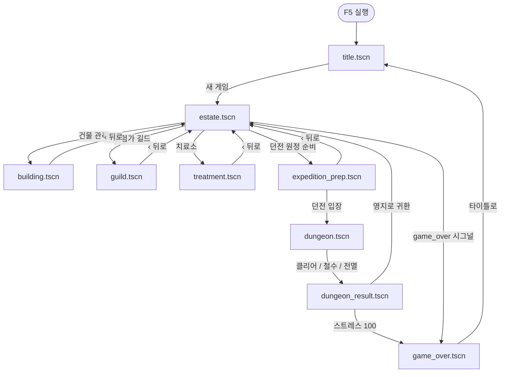

# Eradel 씬 흐름 Overview

게임이 **어떤 씬에서 시작**하고, **어느 코드가 다음 씬을 부르는지** 정리한 문서입니다.

이 문서는 씬 계층·전환의 **소스 오브 트루스**입니다. 코드와 어긋나면 **문서를 먼저 고친다**(또는 코드와 같이 고친다).

파일 역할·시그널·중요 함수·호출 관계는 [`overview_detail.md`](overview_detail.md)를 본다.

## 유지 체크리스트 (씬 작업 시)

- [ ] `project.godot` `run/main_scene` — 진입점이 맞는지
- [ ] `GameState` `SCENE_*` — 경로 상수 추가·수정
- [ ] `change_scene_to_file(GameState.SCENE_*)` — 전환 연결
- [ ] 이 문서 **§2** 상수 · **§3** Mermaid · **§4** 전환 표 · **§7** 요약 갱신
- [ ] API·시그널·파일 역할이 바뀌면 [`overview_detail.md`](overview_detail.md)도 갱신
- [ ] (선택) F5 후 좌측 상단 디버그 라벨로 현재 씬 경로 확인

---

## 1. 게임 시작 (최상위 씬)

Godot **F5** 실행 시 `project.godot`에 지정된 씬이 먼저 올라옵니다.

```ini
# project.godot
run/main_scene="res://scenes/ui/title.tscn"
```

| 항목 | 값 |
|------|-----|
| 메인 씬 | `scenes/ui/title.tscn` |
| 스크립트 | `scenes/ui/title.gd` |
| Autoload | `GameState` (`scripts/autoload/game_state.gd`) — **모든 씬 전환 후에도 유지** |

---

## 2. 씬 경로 상수 (한곳에서 관리)

모든 씬 경로는 `GameState`에 문자열 상수로 정의되어 있습니다.

```gdscript
# scripts/autoload/game_state.gd (15~23행)
const SCENE_TITLE      := "res://scenes/ui/title.tscn"
const SCENE_ESTATE     := "res://scenes/world/estate.tscn"
const SCENE_GUILD      := "res://scenes/ui/guild.tscn"
const SCENE_PREP       := "res://scenes/ui/expedition_prep.tscn"
const SCENE_DUNGEON    := "res://scenes/world/dungeon.tscn"
const SCENE_RESULT     := "res://scenes/ui/dungeon_result.tscn"
const SCENE_BUILDING   := "res://scenes/ui/building.tscn"
const SCENE_TREATMENT  := "res://scenes/ui/treatment.tscn"
const SCENE_GAMEOVER   := "res://scenes/ui/game_over.tscn"
```

실제 전환은 전부 아래 API로 이루어집니다.

```gdscript
get_tree().change_scene_to_file(경로)
```

→ **현재 씬 트리를 통째로 바꿉니다.** (팝업이 아니라 화면 전체 교체)

---

## 3. 전체 흐름도



---

## 4. 씬 전환 목록 (트리거 → 코드 위치)

### 4-1. 타이틀 → 영지

| From | To | 트리거 | 파일 | 구문 |
|------|-----|--------|------|------|
| `title.tscn` | `estate.tscn` | **「새 게임」** 버튼 클릭 | `scenes/ui/title.gd` | `_on_new_game()` |

```gdscript
# scenes/ui/title.gd:65-67
func _on_new_game() -> void:
    GameState.new_game()                              # 상태 초기화
    get_tree().change_scene_to_file(GameState.SCENE_ESTATE)
```

`new_game()`에서 금화·용병·스트레스 등을 초기화한 **뒤** 영지로 이동합니다.

---

### 4-2. 영지 허브 → 서브 화면

| From | To | 트리거 | 파일 | 대략적 위치 |
|------|-----|--------|------|-------------|
| `estate.tscn` | `building.tscn` | **「건물 관리」** 버튼 | `scenes/world/estate.gd` | `_build_left()` 내 `b_build.pressed` |
| `estate.tscn` | `guild.tscn` | **「모험가 길드」** 버튼 | `scenes/world/estate.gd` | `b_guild.pressed` |
| `estate.tscn` | `treatment.tscn` | **「치료소」** 버튼 | `scenes/world/estate.gd` | `b_treat.pressed` |
| `estate.tscn` | `expedition_prep.tscn` | **「던전 원정 준비 ↗」** 버튼 | `scenes/world/estate.gd` | `go.pressed` |

예시 (건물 관리):

```gdscript
# scenes/world/estate.gd
b_build.pressed.connect(func(): get_tree().change_scene_to_file(GameState.SCENE_BUILDING))
```

---

### 4-3. 서브 화면 → 영지 (뒤로)

| From | To | 트리거 | 파일 |
|------|-----|--------|------|
| `building.tscn` | `estate.tscn` | 상단 **「‹ 뒤로」** | `scenes/ui/building.gd` |
| `guild.tscn` | `estate.tscn` | 상단 **「‹ 뒤로」** | `scenes/ui/guild.gd` |
| `treatment.tscn` | `estate.tscn` | 상단 **「‹ 뒤로」** | `scenes/ui/treatment.gd` |
| `expedition_prep.tscn` | `estate.tscn` | 상단 **「‹ 뒤로」** | `scenes/ui/expedition_prep.gd` |

뒤로 버튼은 `UiKit.top_bar()`의 두 번째 인자(Callable)로 연결됩니다.

```gdscript
# 예: scenes/ui/guild.gd:23
UiKit.top_bar("모험가 길드", func(): get_tree().change_scene_to_file(GameState.SCENE_ESTATE))
```

---

### 4-4. 원정 준비 → 던전

| From | To | 트리거 | 파일 | 구문 |
|------|-----|--------|------|------|
| `expedition_prep.tscn` | `dungeon.tscn` | **「던전 입장 ↗」** 버튼 | `scenes/ui/expedition_prep.gd` | `_on_enter()` |

```gdscript
# scenes/ui/expedition_prep.gd:146-149
func _on_enter() -> void:
    for m in GameState.party:
        m.status = Mercenary.Status.ON_EXPEDITION   # 파티 상태 변경
    get_tree().change_scene_to_file(GameState.SCENE_DUNGEON)
```

파티가 비어 있으면 버튼이 비활성화되어 이 함수가 호출되지 않습니다.

---

### 4-5. 던전 → 결과

| From | To | 트리거 | 파일 | 구문 |
|------|-----|--------|------|------|
| `dungeon.tscn` | `dungeon_result.tscn` | 전투 종료 | `scenes/world/dungeon.gd` | `_end(outcome)` |

`_end()`가 호출되는 경우:

| outcome | 조건 | 버튼/상황 |
|---------|------|-----------|
| `"clear"` | 살아 있는 몬스터 0마리 | **「다음 턴 ▶」** 반복 후 자동 |
| `"retreat"` | **「철수」** 버튼 (1턴 이후 활성) | 사용자 선택 |
| `"wipe"` | 살아 있는 파티원 0명 | **「다음 턴 ▶」** 반복 후 자동 |

```gdscript
# scenes/world/dungeon.gd:200-205
func _end(outcome: String) -> void:
    if _finished:
        return
    _finished = true
    GameState.finalize_expedition(outcome, _base_gold)   # 결과 계산 → last_result 저장
    get_tree().change_scene_to_file(GameState.SCENE_RESULT)
```

`finalize_expedition()`이 사망·전리품·스트레스 변화를 **`GameState.last_result`**에 넣습니다. 결과 화면은 이 딕셔너리를 읽어 표시합니다.

---

### 4-6. 결과 → 영지 / 게임 오버

| From | To | 트리거 | 파일 | 구문 |
|------|-----|--------|------|------|
| `dungeon_result.tscn` | `estate.tscn` | **「영지로 귀환 ↗」** (스트레스 &lt; 100) | `dungeon_result.gd` | `_on_return()` |
| `dungeon_result.tscn` | `game_over.tscn` | **「영지로 귀환 ↗」** (스트레스 ≥ 100) | `dungeon_result.gd` | `_on_return()` |
| `dungeon_result.tscn` | `estate.tscn` | `last_result` 비어 있을 때 (비정상 진입) | `dungeon_result.gd` | `_ready()` |

```gdscript
# scenes/ui/dungeon_result.gd:163-168
func _on_return() -> void:
    GameState.return_to_estate()    # 자원·스트레스·날짜 실제 반영
    if GameState.total_stress() >= GameState.MAX_STRESS:
        get_tree().change_scene_to_file(GameState.SCENE_GAMEOVER)
    else:
        get_tree().change_scene_to_file(GameState.SCENE_ESTATE)
```

귀환 버튼을 누르기 **전**에는 `last_result`만 보여 주고, **누른 뒤** `return_to_estate()`가 수치를 실제로 적용합니다.

---

### 4-7. 영지 → 게임 오버 (시그널)

| From | To | 트리거 | 파일 | 구문 |
|------|-----|--------|------|------|
| `estate.tscn` | `game_over.tscn` | 스트레스 100 도달 | `estate.gd` | `_on_game_over()` |

```gdscript
# estate.gd — _ready()에서 연결
GameState.game_over.connect(_on_game_over)

func _on_game_over() -> void:
    get_tree().change_scene_to_file(GameState.SCENE_GAMEOVER)
```

`game_over` 시그널은 `GameState.add_permanent_stress()` / `add_resolvable_stress()` 등으로 총 스트레스가 100이 되면 `_check_game_over()`에서 emit 됩니다.

※ 던전 결과 화면에서 귀환할 때도 스트레스 100이면 `game_over` 시그널 **전에** `_on_return()`에서 직접 `SCENE_GAMEOVER`로 갑니다.

---

### 4-8. 게임 오버 → 타이틀

| From | To | 트리거 | 파일 |
|------|-----|--------|------|
| `game_over.tscn` | `title.tscn` | **「타이틀로」** 버튼 | `scenes/ui/game_over.gd` |

```gdscript
btn.pressed.connect(func(): get_tree().change_scene_to_file(GameState.SCENE_TITLE))
```

---

## 5. 한 판 플레이의典型 경로

```
F5
 → title (새 게임)
 → estate (허브)
 → expedition_prep (파티 편성)
 → dungeon (턴제 전투)
 → dungeon_result (결과 확인)
 → estate (귀환, 날짜 +1)
 → … 반복 …
 → game_over (스트레스 100) 또는 title (의도적 종료)
```

영지에서 길드·건물·치료소는 **허브 ↔ 서브** 왕복이며, 던전 루프와 독립적으로 들어갔다 나올 수 있습니다.

---

## 6. 씬 전환이 **아닌** 것들

| 동작 | 설명 |
|------|------|
| `GameState` Autoload | 씬이 바뀌어도 **같은 인스턴스** 유지 (금화, 파티, 스트레스 등) |
| `estate.gd`의 `_rebuild()` | 같은 씬 안에서 UI만 다시 그림 (`queue_free` + 재생성) |
| `dungeon.gd`의 `_rebuild()` | 전투 중 HP·로그 UI 갱신 (씬 전환 없음) |
| 길드 모집·치료·건물 업그레이드 | `GameState` 함수만 호출, 씬 전환 없음 |

---

## 7. 파일별 `change_scene_to_file` 요약

| 파일 | 호출 횟수 | 이동 대상 |
|------|-----------|-----------|
| `title.gd` | 1 | → estate |
| `estate.gd` | 5 | → building, guild, treatment, prep, gameover |
| `building.gd` | 1 | → estate |
| `guild.gd` | 1 | → estate |
| `treatment.gd` | 1 | → estate |
| `expedition_prep.gd` | 2 | → estate, dungeon |
| `dungeon.gd` | 1 | → result |
| `dungeon_result.gd` | 3 | → estate (×2), gameover |
| `game_over.gd` | 1 | → title |

---

## 8. 새 씬을 추가할 때

- [ ] `.tscn` + `.gd` 작성 (`scenes/ui/` 또는 `scenes/world/`)
- [ ] `game_state.gd`에 `const SCENE_XXX := "res://..."` 추가
- [ ] 진입: `get_tree().change_scene_to_file(GameState.SCENE_XXX)` 연결
- [ ] 복귀: 필요 시 `UiKit.top_bar(..., func(): change_scene_to_file(SCENE_ESTATE))` 재사용
- [ ] 이 overview **§2 / §3 / §4 / §7** 갱신 (위 유지 체크리스트)
- [ ] [`overview_detail.md`](overview_detail.md) — 역할·API·시그널·매트릭스 갱신

기획서 UI 흐름도: `docs/design/영지의군주_UI설계서_v0.4.html`
