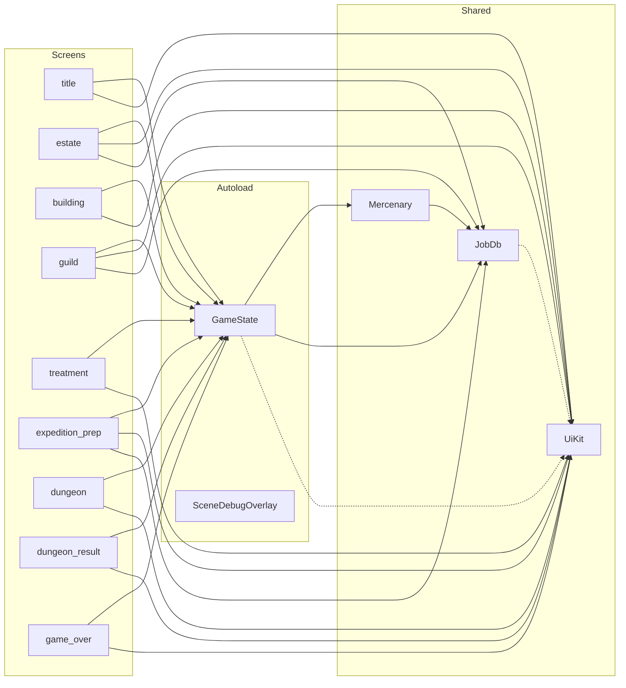
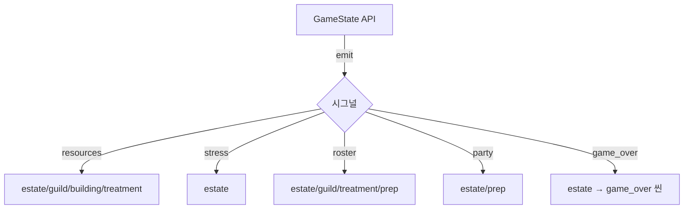
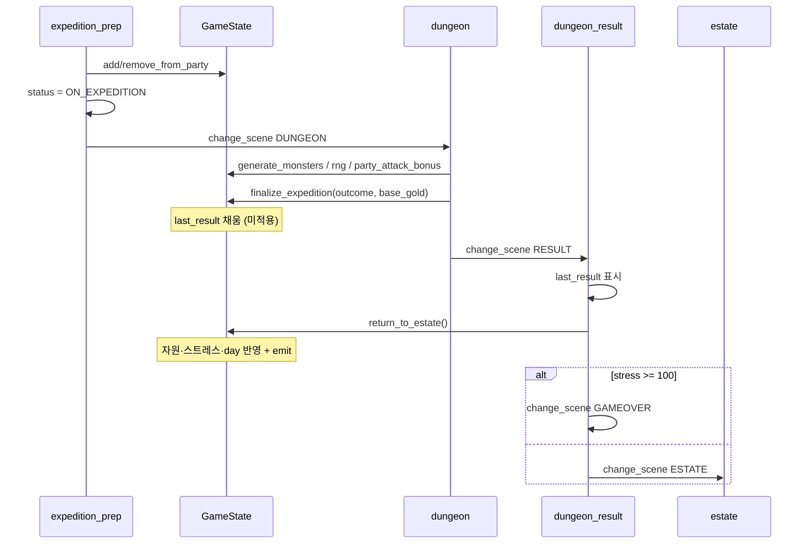

# Eradel 씬·스크립트 Detail

씬 **전환 지도**는 [`overview.md`](overview.md)를 본다.  
이 문서는 **파일 역할**, **함수/시그널로 주고받는 관계**, **중요 API**를 정리한다.

구조 규칙: UI는 `.tscn` 셸 + 런타임 코드 조립. 시그널 정의는 사실상 `GameState`만. 화면 간 직접 호출은 없고 **`GameState`를 허브**로 통신한다.

---

## 0. 한눈에 보는 의존성

| 방향 | 의미 |
|------|------|
| 화면 → `GameState` | 상태 읽기 / API 호출 / 시그널 `connect` |
| 화면 → `UiKit` | UI 위젯 조립 |
| `GameState` → `Mercenary`/`JobDb` | 용병·직업 데이터 |
| 화면 ↔ 화면 | **직접 참조 없음** (씬 전환 + 공유 상태만) |

---

## 1. 통신 모델

### 1-1. GameState 시그널 ↔ 수신자

| 시그널 | emit 시점 (대략) | 연결하는 씬 | 수신 시 동작 |
|--------|------------------|-------------|--------------|
| `resources_changed` | `spend` / `add_*` / `recruit` / `return_to_estate` | estate, guild, building, treatment | `_rebuild()` |
| `stress_changed` | `add_*_stress` / 주점 효과 | **estate만** | `_rebuild()` |
| `roster_changed` | `recruit` / `treat_penalty` / `return_to_estate` | estate, guild, treatment, expedition_prep | `_rebuild()` |
| `party_changed` | `add/remove_from_party` / `return_to_estate` | estate, expedition_prep | `_rebuild()` |
| `game_over` | `_check_game_over()` (총 스트레스 ≥ 100) | **estate만** | `_on_game_over()` → `SCENE_GAMEOVER` |

### 1-2. 시그널이 아닌 이벤트

| 종류 | 예 | 설명 |
|------|-----|------|
| `Button.pressed` | 모든 UI 버튼 | 씬 내부에서만 연결 |
| `change_scene_to_file` | 화면 전체 교체 | Autoload(`GameState`)만 유지 |
| `last_result` 딕셔너리 | dungeon → result | 씬 간 전달 버퍼 (시그널 아님) |

### 1-3. 원정 2단계 커밋 (중요)

1. **`finalize_expedition`** (dungeon 종료 시)  
   - 사망/실종/패널티·전리품·지표 **계산**  
   - `last_result`에만 저장 · **금화/스트레스/날짜는 아직 반영 안 함**
2. **`return_to_estate`** (결과 화면 「영지로 귀환」)  
   - `last_result`를 실제 상태에 **적용** · day+1 · AP 리필 · 시그널 emit · GO 체크

결과 화면은 적용 **전** 스냅샷을 보여주고, 버튼 후에야 세계가 바뀐다.

### 1-4. 게임오버 이중 경로

| 경로 | 조건 | 코드 |
|------|------|------|
| A. estate 리스너 | `game_over` 시그널 | `estate._on_game_over` |
| B. 결과 화면 직접 | 귀환 직후 `total_stress() >= 100` | `dungeon_result._on_return` |

B가 필요한 이유: 귀환 시점에는 estate가 없어서 A의 리스너가 없음.  
`return_to_estate` 안에서도 `_check_game_over()`가 emit하지만, 그 순간 estate는 아직 로드되지 않은 경우가 많다.

---

## 2. 파일별 역할 · 중요 함수

### 2.1 Autoload

#### `scripts/autoload/game_state.gd` — 전역 런 상태 / 운영 API

| 구분 | 내용 |
|------|------|
| 역할 | 자원·스트레스·명단·건물·원정 결과의 **단일 진실 소스**. 씬 경로 상수 보관 |
| 의존 | `Mercenary`, `JobDb`, (UI색) `UiKit` |
| 씬 전환 | 직접 안 함. 상수만 제공 |

**상태 필드:** `gold`, `manastone`, `action_points`, `day`, `morale`, `dungeon_activity`, `monster_tier`, `stress_*`, `roster`, `party`, `death_log`, `buildings`, `last_result`

| 함수 | 역할 |
|------|------|
| `new_game()` | 런 초기화 + 일반 용병 3명 |
| `can_afford` / `spend` / `add_gold` / `add_manastone` | 자원 |
| `season()` | 일차 → 계절 문자열 |
| `total_stress` / `add_resolvable_stress` / `add_permanent_stress` | 스트레스 + GO 체크 |
| `stress_stage` / `stress_color` | UI용 단계·색 |
| `recruit(grade)` | AP·금화 소모 후 랜덤 용병 추가 |
| `available_mercs` / `add_to_party` / `remove_from_party` | 파티 편성 |
| `party_attack_bonus()` | 대장간 Lv 기반 공격 보너스 |
| `heal_success_rate` / `injured_mercs` / `treat_penalty` | 치료소 |
| `upgrade_cost` / `can_upgrade` / `upgrade_building` | 건물 (최대 Lv5) |
| `generate_monsters()` | 던전용 몬스터 Dict 배열 |
| `rng()` | 공유 RNG |
| `finalize_expedition(outcome, base_gold)` | 원정 결과 → `last_result` |
| `return_to_estate()` | 결과 적용 + 날짜 진행 |
| `_check_game_over()` | 스트레스 ≥100 → `game_over.emit()` |
| `_maybe_add_penalty` | 생존자 패널티 확률 부여 |

**`last_result` 키:**  
`outcome`, `survivors`, `dead`, `missing`, `gold_gain`, `mana_gain`, `resolvable_delta`, `permanent_gain`, `morale_delta`, `activity_delta`

**outcome 요약 (`finalize_expedition`):**

| | clear | retreat | wipe |
|---|-------|---------|------|
| 금화 | base | 30% | 0 |
| 마나 | 1–3 | 0 | 0 |
| 해소 스트레스 | −8 | +5 | +10 |
| 영구 스트레스 | 사망자 합 | (실종은 영구 X) | 사망자 +20 |
| 민심 / 활성도 | +5 / −30 | −5 / 0 | −15 / +10 (+tier) |

---

#### `scripts/autoload/scene_debug_overlay.gd` — 디버그 HUD

| 함수 | 역할 |
|------|------|
| `_ready` | 릴리스면 제거; CanvasLayer layer=128 |
| `_process` / `_refresh_path` | `current_scene.scene_file_path` 표시 |

다른 스크립트와 **무연결**.

---

### 2.2 공유 라이브러리

#### `scripts/ui_kit.gd` (`class_name UiKit`)

| 역할 | 모든 화면의 색 팔레트·위젯 팩토리 |
|------|-----------------------------------|

| 함수 | 역할 |
|------|------|
| `style` / `panel` / `label` / `title` | 기본 위젯 |
| `button` / `primary_button` | 버튼 스타일 |
| `chip` / `progress` / `hsep` / `avatar` | 장식·게이지 |
| `top_bar(title, on_back?)` | 뒤로 + **GameState 금화/마나/AP 칩 읽기** |
| `background(parent, color)` | 풀스크린 배경 |

---

#### `scripts/data/mercenary.gd` (`class_name Mercenary`)

| 역할 | 용병 1명 Resource (저장 대비) |
|------|------------------------------|

| 멤버/함수 | 역할 |
|-----------|------|
| `Status` | READY / ON_EXPEDITION / TREATING / MISSING / DEAD |
| `create_random(grade, rng)` | JobDb로 랜덤 생성 |
| `is_available` / `is_alive` | 상태·생존 판정 |
| `status_text` | 한글 상태 |
| `permanent_stress_value()` | 사망 시 영구 스트레스 (Lv 구간) |

---

#### `scripts/data/job_db.gd` (`class_name JobDb`)

| 역할 | 직업·모집비·패널티 정적 DB |
|------|---------------------------|

| 상수/함수 | 역할 |
|-----------|------|
| `CATEGORIES` / `RECRUIT_COST` / `GRADE_LEVEL` | 직업·비용·레벨 |
| `NAME_*` / `PENALTY_POOL` | 이름·패널티 풀 |
| `random_name/category/job/penalty` | 생성용 |
| `category_color` / `grade_color` | UI 색 (UiKit 상수 참조) |

---

### 2.3 화면 스크립트

공통 패턴: `extends Control` → `_ready`에서 시그널/`UiKit.background` → `_rebuild()`로 UI 재생성.

---

#### `scenes/ui/title.gd` — ENTRY

| 호출 OUT | `GameState.new_game()` → `SCENE_ESTATE` / `get_tree().quit()` |
|----------|---------------------------------------------------------------|
| 시그널 IN | 없음 |

| 함수 | 역할 |
|------|------|
| `_ready` | 타이틀 아트·버튼 조립 |
| `_on_new_game` | 새 런 시작 |

※ 「불러오기」 버튼은 비활성(미구현).

---

#### `scenes/world/estate.gd` — HUB

| 시그널 IN | resources / stress / party / roster → `_rebuild` · `game_over` → `_on_game_over` |
|-----------|----------------------------------------------------------------------------------|
| 씬 OUT | building, guild, treatment, prep, game_over |

| 함수 | 역할 |
|------|------|
| `_ready` | GameState 시그널 5개 연결 |
| `_on_game_over` | 게임오버 씬 |
| `_rebuild` | 좌·중·우 레이아웃 재생성 |
| `_build_left/center/right` | 지표·이동 / 지도·스트레스 / 파티·원정 |
| `_stat_row` / `_member_row` | 위젯 |

읽기: day, season, morale, activity, tier, stress_*, party.

---

#### `scenes/ui/building.gd` — SUB

| 시그널 IN | `resources_changed` → `_rebuild` |
|-----------|----------------------------------|
| API | `upgrade_cost` / `can_upgrade` / `upgrade_building` |
| 씬 OUT | estate (뒤로) |

| 함수 | 역할 |
|------|------|
| `_rebuild` / `_building_card` | 건물 카드·업그레이드 |

로컬 `EFFECTS` Dict는 **표시용**. GameState에 실질 연결된 효과는 대장간·치료소·주점 위주.

---

#### `scenes/ui/guild.gd` — SUB

| 시그널 IN | resources / roster → `_rebuild` |
|-----------|---------------------------------|
| API | `recruit`, `can_afford`, roster/death_log 읽기 |
| 외부 | `JobDb.RECRUIT_COST`, 색상 |
| 씬 OUT | estate |

| 함수 | 역할 |
|------|------|
| `_rebuild` | 모집·명단·사망 로그 |
| `_recruit_card` / `_on_recruit` | 등급별 모집 |
| `_merc_card` | 용병 행 |

---

#### `scenes/ui/treatment.gd` — SUB

| 시그널 IN | resources / roster → `_rebuild` |
|-----------|---------------------------------|
| API | `injured_mercs`, `heal_success_rate`, `treat_penalty`, `can_afford` |
| 씬 OUT | estate |

| 함수 | 역할 |
|------|------|
| `_rebuild` / `_merc_card` / `_penalty_row` | 부상 용병 UI |
| `_on_treat` | 치료 시도 + 로컬 메시지 |

---

#### `scenes/ui/expedition_prep.gd` — SUB → RUN

| 시그널 IN | party / roster → `_rebuild` |
|-----------|-----------------------------|
| API | `available_mercs`, `add/remove_from_party` |
| 씬 OUT | estate(뒤로), **dungeon(입장)** |

| 함수 | 역할 |
|------|------|
| `_rebuild` / `_build_party` / `_build_available` / `_slot` | 편성 UI |
| `_difficulty_text` | 활성도+tier → 난이도 문구 |
| `_on_enter` | party → `ON_EXPEDITION` 후 던전 씬 |

---

#### `scenes/world/dungeon.gd` — RUN

| 시그널 IN | 없음 (전투 중 GameState emit 거의 없음) |
|-----------|------------------------------------------|
| API | `generate_monsters`, `rng`, `party_attack_bonus`, `finalize_expedition` |
| 로컬 상태 | `_monsters`, `_base_gold`, `_round`, `_log`, `_finished` |
| 씬 OUT | **result** |

| 함수 | 역할 |
|------|------|
| `_ready` | party HP 풀 · 몬스터 생성 · base_gold 산출 |
| `_rebuild` | 전투 UI (뒤로 버튼 없음) |
| `_next_turn` | 아군 타격 → 몬스터 반격 → clear/wipe 판정 |
| `_end(outcome)` | finalize → SCENE_RESULT |
| `_alive_party` / `_alive_monsters` | 생존 필터 |

전투식: 아군 `attack + party_attack_bonus + rng(0,6)` / 몬스터 `attack + rng(0,5)`.  
철수는 `_round >= 1`부터.

---

#### `scenes/ui/dungeon_result.gd` — RESULT

| API | `last_result` 읽기 · `return_to_estate` · `total_stress` |
|-----|----------------------------------------------------------|
| 씬 OUT | estate / game_over (스트레스) · 빈 last_result면 estate 폴백 |

| 함수 | 역할 |
|------|------|
| `_ready` | 테마·본문 조립 / 빈 결과면 즉시 이탈 |
| `_theme_for` | clear/retreat/wipe 색·문구 |
| `_build_party` / `_build_loot` / `_build_ripple` | 결과·전리품·파문 미리보기 |
| `_on_return` | 적용 후 GO 분기 |

파문 미리보기는 `total_stress() + resolvable_delta + permanent_gain` (적용 **전**).

---

#### `scenes/ui/game_over.gd` — END

| API | day / stress / death_log / morale **읽기만** |
|-----|----------------------------------------------|
| 씬 OUT | `SCENE_TITLE` (`new_game` 호출 안 함) |

| 함수 | 역할 |
|------|------|
| `_ready` | 요약 화면 |
| `_stat` | 통계 행 |

초기화는 타이틀 「새 게임」에서 `new_game()`이 담당.

---

## 3. 호출 관계 매트릭스

| 스크립트 | GameState | UiKit | Mercenary | JobDb | change_scene |
|----------|-----------|-------|-----------|-------|--------------|
| game_state | — | 색 | ✓ | ✓ | 상수만 |
| scene_debug | — | — | — | — | — |
| ui_kit | top_bar 필드 읽기 | — | — | — | — |
| mercenary | — | — | — | ✓ | — |
| job_db | — | 색 | — | — | — |
| title | `new_game` | ✓ | — | — | estate |
| estate | 다수+시그널 | ✓ | ✓ | ✓ | 5곳 |
| building | upgrade* | ✓ | — | — | estate |
| guild | recruit 등 | ✓ | ✓ | ✓ | estate |
| treatment | treat* | ✓ | ✓ | — | estate |
| prep | party* | ✓ | ✓ | ✓ | estate/dungeon |
| dungeon | combat API | ✓ | ✓ | — | result |
| result | last_result, return | ✓ | ✓ | — | estate/GO |
| game_over | 읽기 | ✓ | — | — | title |

---

## 4. 시퀀스: 원정 한 바퀴

---

## 5. 문서 유지

| 바뀌는 것 | 갱신 문서 |
|-----------|-----------|
| 씬 경로·전환 화살표 | [`overview.md`](overview.md) |
| API·시그널·파일 역할·함수 | **이 문서** (`overview_detail.md`) |
| 둘 다 | 씬 추가 / GameState 공개 API 변경 시 |

체크리스트 (detail):

- [ ] 새 시그널 / emit 위치 / `connect` 수신자
- [ ] 공개 API 표 (§2.1)
- [ ] 호출 매트릭스 (§3)
- [ ] 원정 2단계·GO 이중 경로 설명이 아직 유효한지
