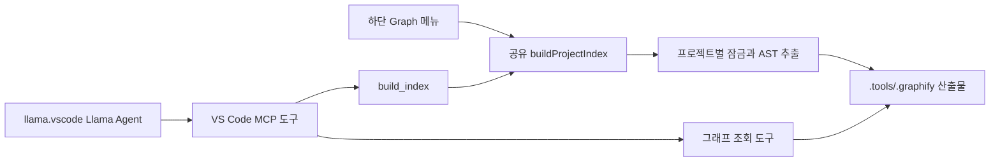

# Lightweight Graph MCP

프로젝트 소스에서 코드 그래프를 만들고, llama.vscode 등의 AI 에이전트가 MCP로 조회하는 VS Code 확장입니다. 코드 파싱은 로컬 Tree-sitter WASM으로 수행하며 Python·Graphify CLI·Docker·외부 API가 필요하지 않습니다.

## 설치와 그래프 생성

VS Code 1.102 이상이 필요합니다. llama.vscode 0.0.73은 자체적으로 VS Code 1.109 이상을 요구하므로 함께 사용할 때는 두 확장의 요구사항을 모두 만족해야 합니다.

1. 확장 보기의 `… → VSIX에서 설치`에서 빌드된 `lightweight-graph-mcp-1.0.1.vsix`를 설치합니다.
2. VS Code 창을 다시 로드하고 분석할 프로젝트 폴더를 엽니다.
3. **하단 상태표시줄의 `Graph: 그래프 생성`을 클릭**합니다.
4. **현재 프로젝트 그래프 생성·갱신**을 선택합니다.
5. 생성 완료 메시지에서 파일·심볼 수와 구문 경고를 확인합니다.

생성은 수동 스냅샷 방식입니다. 최초 실행이나 파일 저장 시 자동 생성하지 않습니다. 소스를 변경한 뒤 같은 메뉴로 갱신하거나 에이전트에서 `build_index`를 호출하세요. 기존 파일 감시 기반 자동 갱신은 이 흐름으로 대체했습니다.

여러 프로젝트 폴더를 연 경우 활성 편집기가 속한 프로젝트를 사용합니다. 활성 프로젝트가 없으면 선택창을 표시합니다. 신뢰한 로컬 작업 영역만 지원합니다.

## llama.vscode 연결

설치된 `ggml-org.llama-vscode` 0.0.73의 MCP 도구 선택 방식에 맞춘 절차입니다. [공식 MCP 안내](https://github.com/ggml-org/llama.vscode/wiki/Mcp-support)에서도 VS Code MCP 서버를 시작한 뒤 Llama Agent에서 도구를 선택하도록 안내합니다.

1. 위 방법으로 프로젝트 그래프를 생성합니다. 먼저 MCP를 시작하고 나중에 `build_index`로 생성해도 됩니다.
2. **하단 Graph 클릭 → MCP 서버 시작·중지**를 선택합니다.
3. 표시되는 VS Code 서버 목록에서 **Lightweight Graph MCP → Start Server/서버 시작**을 선택합니다. 다중 폴더에서는 서버 이름 뒤에 프로젝트 이름이 붙습니다.
4. VS Code가 서버 실행 신뢰 여부를 물으면 대상과 명령을 확인합니다.
5. **하단 Graph 클릭 → Llama Agent 열기**, 또는 `Ctrl+Shift+A`를 사용합니다.
6. llama.vscode에서 도구 호출을 지원하는 모델·환경을 선택합니다. 로컬 환경에서는 llama.vscode의 Tools 모델 설정 및 서버 실행이 필요합니다.
7. Llama Agent의 **Select Tools**에서 Graph 서버 도구를 선택하고 **OK**를 누릅니다. 표시 이름에는 VS Code가 서버 접두사를 붙일 수 있습니다.
8. 다음처럼 요청합니다.

> 먼저 get_index_status로 상태를 확인해 줘. 색인이 없거나 코드가 변경됐다면 build_index로 갱신한 뒤 search_symbols와 get_callers로 관련 코드를 분석해 줘.

`build_index`는 **Graph 확장의 MCP 서버가 제공하는 도구**입니다. llama.vscode 내부에 추가하는 명령이 아닙니다. 서버 시작 후 Select Tools에 표시되며, 선택한 도구를 모델이 필요에 따라 호출합니다. 조회만 원한다면 생성 도구를 선택하지 않아도 됩니다.

이는 **Llama Agent 연결**입니다. 인라인 자동완성에 그래프를 자동 주입하거나 매 요청마다 도구 사용을 강제하는 기능은 없습니다. 도구 선택은 창을 다시 로드한 뒤 다시 확인하세요. 확인한 llama 설치본은 선택 목록을 메모리에 보관하므로 재선택이 필요할 수 있습니다.

MCP 중지도 **Graph → MCP 서버 시작·중지 → 해당 서버 → Stop Server/서버 중지**로 수행합니다. 이 메뉴는 VS Code의 서버 관리 화면을 바로 엽니다. 상태표시줄의 “준비”는 색인 상태이며 MCP 서버 실행 상태를 뜻하지 않습니다.

### 연결이 안 될 때

- **Graph 아이콘이 없음:** 확장이 활성화됐는지, 프로젝트 폴더가 열려 있는지 확인하고 창을 다시 로드합니다.
- **서버가 목록에 없음:** 작업 영역 신뢰, 확장 버전, VS Code 버전을 확인합니다. 1.0.1에서는 누락됐던 MCP Provider manifest 선언을 보완했습니다.
- **도구가 안 보임:** 먼저 해당 MCP 서버를 시작하고 Llama Agent의 Select Tools를 다시 엽니다.
- **모델이 도구를 호출하지 않음:** 도구 호출을 지원하는 Tools 모델·환경인지 확인하고, Select Tools에서 선택 후 OK를 눌렀는지 확인합니다.
- **구문 경고가 있음:** 생성 결과의 `parseErrorFiles`를 확인합니다. 문법 오류 또는 문법 패키지가 지원하지 않는 구문일 수 있습니다.
- **색인 잠금이 남음:** 다른 생성이 실행 중인지 먼저 확인합니다. 비정상 종료 후에는 `.tools/.graphify/index.lock`이 남을 수 있습니다. 실행 프로세스를 확인하기 전에는 잠금을 지우지 마세요.

## 지원 언어

| 언어 | 주요 확장자 | 지원 범위 |
| --- | --- | --- |
| JavaScript | js, jsx, mjs, cjs | 선언·호출·임포트 |
| TypeScript / TSX | ts, mts, cts, tsx | 선언·호출·임포트, TSX 별도 문법 |
| Python | py | 클래스·함수·호출·임포트 |
| Java | java | 클래스·인터페이스·메서드·호출·임포트·상속·구현 |
| Go | go | 타입·함수·메서드·호출·임포트, 메서드 receiver 범위 |
| Rust | rs | struct·enum·trait·함수·impl 범위·호출·use |
| C | c, h | 구조체·타입·함수 정의/선언·호출·include |
| C++ | cc, cpp, cxx, hh, hpp, hxx, ipp, inl, tpp, ixx, cppm 등 | namespace·클래스·함수·호출·include·상속 |
| C# | cs | namespace·클래스·인터페이스·메서드·호출·using·상속 |
| Objective-C | m | 클래스·메서드·C 함수 호출·include/import·상속 |
| Objective-C++ | mm | Objective-C와 C++의 두 AST를 병합하는 **부분 지원** |
| CUDA | cu, cuh | C++ 문법으로 선언·일반 호출을 추출하는 **부분 지원** |

대문자 `.C`·`.H`는 C++로 처리합니다. `.h`는 C 문법에서 오류가 있으면 C++ 문법도 확인합니다. `.m`은 Objective-C로 취급하므로 MATLAB 파일에는 맞지 않습니다.

언어 지원은 AST 기반 코드 구조 추출을 뜻합니다. 컴파일러·언어 서버 수준의 오버로드, 타입, 가상 호출, 매크로 전개, 빌드 시스템의 include/import 경로 해석을 보장하지 않습니다. 설치 문법 버전보다 새로운 구문, Objective-C++ 혼합 구문, CUDA 전용 구문은 구문 경고와 함께 부분 결과가 나올 수 있습니다.

이름 기반 참조 후보는 같은 언어 안에서 찾고, 후보가 여러 개면 미해결로 남깁니다. 서로 다른 언어 사이의 FFI 호출은 자동 연결하지 않습니다.

## 생성 파일과 Graphify와의 차이

모든 산출물은 **`<프로젝트>/.tools/.graphify/`**에 저장합니다. 이 경로를 Git ignore에 추가하세요.

| 파일 | 용도 |
| --- | --- |
| `graph-cache.json` | Graph MCP가 조회하는 자체 심볼·관계 스냅샷 |
| `graph.json` | 상대 경로 ID, 출처, 관계와 신뢰도 태그를 포함한 노드·링크 교환 형식 |
| `GRAPH_REPORT.md` | 심볼·관계·미해결·구문 경고 수를 요약한 한국어 보고서 |

기존 `.mcp/graph-cache.json`은 새 캐시가 없을 때만 읽습니다. 이전 파일은 자동 삭제하지 않습니다. 생성 중에는 프로젝트별 잠금으로 아이콘과 MCP의 동시 쓰기를 막습니다. 생성 실패 시 기존 조회 캐시는 유지하며, 각 파일은 임시 파일을 완성한 뒤 교체합니다. 여러 산출물 전체를 하나의 트랜잭션으로 교체하지는 않으므로 실패 후 재생성하세요.

Graphify를 본받은 부분은 AST 기반 그래프, 출처, 관계 신뢰도 및 노드·링크 내보내기입니다. **Graphify CLI와 동일한 제품이나 완전 호환 형식은 아닙니다.** Graphify의 문서·PDF·미디어 의미 분석, Leiden 커뮤니티 탐지, 자연어 질의·최단 경로·설명 도구, `graph.html` 시각화와 다양한 export는 포함하지 않습니다.

`graph.json`에는 자체 producer와 schema version을 기록하고 Graphify가 생성한 것처럼 `graphify_version`을 붙이지 않습니다. `EXTRACTED`는 직접 추출, `INFERRED`는 추정 연결, `AMBIGUOUS`는 미해결 관계를 나타냅니다. 원래의 내부 certainty도 보존합니다.

기본적으로 node_modules·빌드 산출물·도구/검증 디렉터리 등을 제외하고, 지원 파일 중 2MB 이하만 처리합니다. 현재 `.gitignore` 규칙 전체를 해석하지는 않으므로 색인할 프로젝트 폴더를 정확하게 선택하세요.

## MCP 도구

| 도구 | 용도 |
| --- | --- |
| `build_index` | 고정된 프로젝트 루트의 그래프 생성·갱신. 인수 없음 |
| `get_index_status` | 생성 여부·심볼 수·지원 언어·저장 경로 조회 |
| `get_project_overview` | 프로젝트 통계 |
| `search_symbols` | 이름·ID로 심볼 검색 |
| `get_symbol_info` | 심볼 상세 정보 |
| `get_dependencies` | 심볼의 의존 관계 |
| `get_callers` / `get_callees` | 호출자 / 피호출자 조회 |
| `get_impact` | 직접 호출자 중심의 간단한 영향 범위 |

생성은 `src/mcp/server.ts`의 `build_index` 등록에서 `src/core/build.ts`의 `buildProjectIndex`를 호출합니다. 상태표시줄도 같은 함수를 호출합니다. MCP 입력으로 임의 프로젝트 경로를 넘기는 기능은 없습니다.



## 빌드와 검증

Node.js 18 이상과 npm, 또는 저장소의 `.build/` 포터블 런타임을 사용합니다.

```text
npm install
npm run bundle
node .test/check.cjs
node .test/mcp.cjs
npm test
npm run package
```

`.test/check.cjs`는 언어별 실제 WASM과 생성·오류·UI 연결을 검증하고, `.test/mcp.cjs`는 먼저 생성된 배포 번들에 stdio로 접속합니다. 검증용 파일과 산출물은 `.test/`에 둡니다. 현재 로컬 ignore 규칙에서 `.test`가 제외되어 있다면 다른 checkout에서 사용할 때 검증 파일의 포함 여부를 확인하세요.

`npm test`의 기존 pretest는 TypeScript를 dist에 컴파일합니다. 그 뒤 배포하려면 `npm run bundle`을 다시 실행하거나 prepublish가 실행되는 `npm run package`를 사용하세요.

포터블 예시는 `.build/README.md`를 참고하세요. 번들 명령은 기존 dist를 삭제하지 않고 필요한 번들과 WASM을 갱신합니다.

## 라이선스

MIT. 사용 중인 Tree-sitter 문법과 의존성의 라이선스도 함께 적용됩니다.
